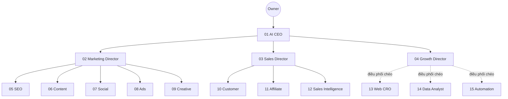
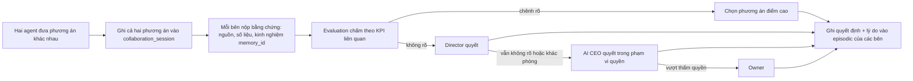

# AGENT_DESIGN: thiết kế 15 Agent và cách phối hợp

> Trạng thái: v0.2 (26/11/2026, theo `DECISIONS.md`), chờ Owner duyệt. Cấu trúc bộ não: `BRAIN_SPEC.md`. Quyền: `SECURITY_PLAN.md` §3.

## 1. Agent là một thực thể có trạng thái

| Thuộc tính | Lưu ở | Ghi chú |
|---|---|---|
| Danh tính, vai trò, cấp trên | `agents`, `agent_profiles` | `agent_id` cố định (vd `seo_agent`) |
| Phiên bản bộ não đang chạy | `agent_brains`, `agent_versions` | Ghim theo task |
| Trạng thái | `agent_status` | `active` · `paused` · `learning` · `waiting_approval` · `degraded` (cầu dao mở) · `disabled` |
| Quyền, công cụ, cấp tự chủ | `agent_permissions`, `tool_registry` | Mặc định từ chối |
| Kỹ năng | `agent_skills` + procedural memory | Có phiên bản |
| Trí nhớ, kinh nghiệm | Bảng memory với `owner_scope = agent:<id>` | RLS |
| KPI, chi phí | `evaluation_results`, `model_usage` | Tính từ đánh giá độc lập |
| Hàng đợi riêng | `queue = agent.<id>` | Giới hạn đồng thời, cầu dao riêng |

**Cầu dao (circuit breaker):** sau 5 lỗi liên tiếp, hoặc khi vượt 100% ngân sách ngày, agent tự chuyển `degraded`. Task mới của agent đó vào hàng chờ. CEO và Owner được báo. Agent khác không bị ảnh hưởng (SRS §21.9).

## 2. Sơ đồ tổ chức

Phòng Công nghệ & Dữ liệu (13–15) chịu sự điều phối chuyên môn của **Growth Director**; CEO có thể giao việc trực tiếp khi cần. Theo quyết định Q-O2, **báo cáo của phòng này gửi thẳng cho Owner qua Telegram**: báo cáo dữ liệu, cảnh báo kỹ thuật, tình trạng tích hợp. Báo cáo 18:00 của AI CEO cũng đi qua Telegram.

## 3. Bốn cấp tự chủ (SRS §13)

| Cấp | Tên | Ví dụ hành động |
|---|---|---|
| L1 | Read only | Đọc dữ liệu, nghiên cứu, phân tích, đề xuất |
| L2 | Draft | Tạo bản nháp, kế hoạch, chiến dịch nháp, gửi bản nháp lên website (chờ duyệt) |
| L3 | Execute | Làm việc đã được cấp phép: đồng bộ dữ liệu, đăng nội dung **đã duyệt**, gửi thông báo nội bộ |
| L4 | Advanced automation | Tự điều phối workflow, tự tối ưu trong giới hạn, chạy hành động đã được duyệt trước theo *chính sách thường trực* |

Cấp được gán theo **(agent × công cụ × hành động)**, không theo agent. Ví dụ Ads Agent là L1 với `ads.read_metrics`, L2 với `ads.create_draft_campaign`, và không có quyền `ads.change_budget`.

**Ngoại lệ do Owner quyết định (Q-A1):** `site.publish` cho **FAQ và blog** được cấp **L3** cho Content Agent và SEO Agent, nhưng chỉ khi Marketing Director đã review đạt, kèm 5 lớp chặn ở ARCHITECTURE ADR-16. Mỗi lần xuất bản đều gửi link qua Telegram, kèm nút Gỡ bài.

**Khởi động an toàn:** ngoài ngoại lệ trên, mọi agent bắt đầu ở L1–L2. Nâng lên L3–L4 là quyết định của Owner. Hệ thống có thể *đề xuất* nâng cấp dựa trên thành tích, ví dụ "50 bài liên tiếp được duyệt nguyên văn", nhưng không tự nâng.

## 4. Thiết kế từng Agent

Ký hiệu hồ sơ model (Model Gateway): `R-hi` lập luận mạnh · `R-mid` lập luận vừa · `W-vi` viết tiếng Việt · `C` rẻ (phân loại, trích xuất) · `L` cục bộ (GPU) · `E` embedding.

Cột "Khả dụng" cho biết agent làm được gì **khi chưa có tích hợp** nào ngoài website moctam: ✅ hoạt động đầy đủ, ◐ chế độ giới hạn, ⛔ cần tích hợp.

### 4.1. Phòng Điều hành

| | 01 AI CEO `ai_ceo` | 02 Marketing Director `marketing_director` | 03 Sales Director `sales_director` | 04 Growth Director `growth_director` |
|---|---|---|---|---|
| Nhiệm vụ | Phân tích mục tiêu, chiến lược, phân bổ ngân sách giữa các phòng, theo dõi, yêu cầu làm lại, báo cáo Owner | Chia việc marketing, review đầu ra của 5 chuyên viên, phản biện, lịch nội dung | Chia việc bán hàng, review lead/đối tác, chính sách giữ chân | Thiết kế thí nghiệm A/B và holdout, tối ưu chuyển đổi, nâng bài học L2 → L3 |
| Model | R-hi; dự phòng R-mid | R-mid | R-mid | R-hi |
| Công cụ chính | `task.*`, `report.compose`, `signals.read`, `analytics.overview` | `task.*`, `review.*`, `content_calendar.*` | `task.*`, `review.*`, `crm.read` | `experiment.*`, `analytics.*`, `task.*` |
| KPI (đo độc lập) | % mục tiêu Owner đạt đúng hạn; % kế hoạch được Owner duyệt không sửa; chi phí trên mục tiêu | Tỉ lệ duyệt đầu ra của phòng; thời gian từ task đến bản duyệt; tăng trưởng organic (GSC) | Lead đủ tiêu chuẩn / tuần; tỉ lệ khách quay lại | Số thí nghiệm hoàn tất và có kết luận; mức tăng chuyển đổi đã kiểm chứng |
| Bắt buộc người duyệt | Mọi thay đổi giá, ngân sách lớn, chính sách (SRS §3.1) | Xuất bản nội dung có rủi ro pháp lý | Liên hệ khách/lead hàng loạt | Chạy thí nghiệm trên trang thật (thay đổi giao diện website) |
| Khả dụng | ✅ | ✅ | ◐ (chưa có CRM) | ◐ (cần GA4 để đo) |

### 4.2. Phòng Marketing

| | 05 SEO `seo_agent` | 06 Content `content_agent` | 07 Social `social_agent` | 08 Ads `ads_agent` | 09 Creative `creative_agent` |
|---|---|---|---|---|---|
| Việc chính | Nghiên cứu từ khóa, đối thủ, ý định tìm kiếm; kế hoạch SEO; bản nháp bài; đề xuất kỹ thuật/on-page/liên kết nội bộ; theo dõi GSC | Bài web, bài Facebook, kịch bản TikTok/livestream, email, lịch nội dung | Xu hướng, lịch đăng, hiệu suất, tương tác, đề xuất chiến dịch | Phân tích chiến dịch, đề xuất ngân sách, CPA/ROAS/CAC, bản nháp chiến dịch, đề xuất điều chỉnh | Banner, ảnh sản phẩm, poster, prompt tạo hình, video quảng cáo theo **Brand Guidelines** |
| Model | R-mid, W-vi | W-vi; dự phòng L | R-mid, C | R-mid | W-vi (prompt), công cụ tạo ảnh/video qua Tool Gateway |
| Công cụ | `web.search`, `web.fetch` (cách ly), `gsc.read`, `site.crawl` (chỉ site mình), `site.catalog`, `site.draft(blog/faq)` | `site.catalog`, `doc.write`, `content_calendar.*`, `image.generate` (nháp), `site.draft` | `social.read_metrics`, `trend.research`, `content_calendar.*` | `ads.read_metrics`, `ads.create_draft_campaign` | `image.generate`, `image.edit`, `video.generate`, `brand.assets.read`, `asset.store` |
| KPI | Tỉ lệ duyệt bản nháp; click/hiển thị GSC của trang đã tối ưu (so với trước, cửa sổ 28 ngày); số lỗi kỹ thuật đã sửa | Tỉ lệ duyệt nguyên văn; hiệu suất bài đã đăng (đo bởi Data Analyst) | Tương tác/lượt tiếp cận các bài đã duyệt; độ chính xác dự báo xu hướng | ROAS/CPA của đề xuất *được áp dụng* so với trước; tỉ lệ đề xuất được duyệt | Tỉ lệ duyệt; tỉ lệ vi phạm brand guideline (kiểm tất định: màu, logo, font) |
| Luật cứng | Không bịa số liệu tìm kiếm khi chưa có nguồn dữ liệu; tự xuất bản chỉ trong hạn mức (ADR-16) | Không khẳng định công dụng chữa bệnh; giá lấy từ website lúc hiển thị; tự xuất bản chỉ khi Director đã review và qua Compliance Gate | Không tự đăng bài | **Không tự tăng ngân sách vượt hạn mức** (SRS); không bật chiến dịch | Không dùng hình người thật hoặc thương hiệu khác; mọi tài nguyên phải gắn nhãn "AI tạo" trong kho |
| Khả dụng | ◐ (đủ khi có GSC) | ✅ | ⛔ cần API nền tảng | ⛔ cần API quảng cáo | ◐ (cần dịch vụ tạo ảnh/video, Q-I6) |

### 4.3. Phòng Kinh doanh

| | 10 Customer `customer_agent` | 11 Affiliate `affiliate_agent` | 12 Sales Intelligence `sales_intelligence` |
|---|---|---|---|
| Việc chính | Soạn câu trả lời cho khách, tư vấn sản phẩm, phân loại khách, theo dõi khiếu nại, đề xuất chăm sóc khách cũ | Tìm KOC/KOL, người livestream, đánh giá độ phù hợp, quản lý đối tác, đề xuất chính sách hoa hồng, theo dõi hiệu quả | Tìm khách sỉ, đại lý, người bán online; nghiên cứu đối thủ; danh sách tiềm năng; chấm điểm |
| Model | W-vi, C | R-mid | R-mid, C |
| Công cụ | `site.catalog` (**chỉ thông tin đã xác thực**), `site.faq`, `support.inbox.read` (đã che dữ liệu), `support.reply_draft`, `site.care_list` | `web.search`, `social.public_profile.read` (qua API chính thức), `partner.*` | `web.search`, `web.fetch`, `lead.*` |
| KPI | % câu trả lời được nhân viên gửi không cần sửa; thời gian phản hồi; khiếu nại đóng | Đối tác ký mới; doanh thu gắn mã đối tác | Lead đạt chuẩn / lead đề xuất; tỉ lệ chuyển thành đơn sỉ |
| Luật cứng | Chỉ dùng thông tin sản phẩm đã xác thực (SRS); câu hỏi sức khỏe/dị ứng chuyển người; **không tự gửi tin cho khách** (L2) | **Chỉ dữ liệu công khai qua kênh hợp pháp**, không scrape trái ToS; liên hệ đối tác cần Owner duyệt | Như Affiliate; mỗi dòng lead phải có nguồn; không thu thập dữ liệu cá nhân nhạy cảm |
| Khả dụng | ◐ (cần kênh hỗ trợ: Zalo OA/email) | ◐ | ✅ (nghiên cứu web; lưu ý Q-L3) |

### 4.4. Phòng Công nghệ & Dữ liệu

| | 13 Web CRO `web_cro_agent` | 14 Data Analyst `data_analyst` | 15 Automation `automation_agent` |
|---|---|---|---|
| Việc chính | Phân tích trang sản phẩm, tỉ lệ thoát, phễu thanh toán; đề xuất giao diện; đề xuất A/B | Doanh thu, chi phí, lợi nhuận, hiệu quả quảng cáo, KPI, báo cáo; **cung cấp số liệu cho Evaluation Service** | Kết nối nền tảng, workflow, lịch, đồng bộ dữ liệu, theo dõi lỗi hệ thống |
| Model | R-mid | R-mid (diễn giải) + **tính toán bằng mã** (không để LLM tự cộng số) | C, R-mid |
| Công cụ | `ga4.read`, `site.page_audit` (Lighthouse cục bộ), `site.funnel_stats` | `sql.readonly` trên **schema phân tích** (view đã ẩn danh), `python.sandbox` (không mạng), `site.aggregates`, `finance.read` (giá vốn, phạm vi riêng) | `integration.status`, `workflow.*`, `n8n.trigger` (nếu bật), `alerts.*` |
| KPI | Mức tăng chuyển đổi đã kiểm chứng từ đề xuất được áp dụng | Báo cáo đúng hạn; sai lệch số liệu so với website = 0 (đối soát tự động) | Thời gian tích hợp hoạt động; số lỗi đồng bộ tự phát hiện trước khi người thấy |
| Luật cứng | Không sửa website; đề xuất đi qua bản nháp hoặc Owner | Không kết luận nhân quả từ tương quan; mỗi con số có truy vấn nguồn | **Không tự sửa mã production**, không đọc secret (SRS §15); chỉ bật/tắt workflow đã duyệt |
| Khả dụng | ◐ (cần GA4) | ✅ (dữ liệu đơn từ website) | ✅ |

## 5. Giao tiếp giữa các agent (SRS §6)

Message chuẩn theo đúng schema SRS §6.1. Bổ sung các trường:
- `conversation_id` (luồng hội thoại);
- `correlation_id` (gắn với task gốc);
- `idempotency_key`;
- `expires_at`;
- `trust` (nội dung có chứa dữ liệu bên ngoài chưa xác minh hay không).

| Loại | Ai gửi | Ai xử lý | Hệ quả |
|---|---|---|---|
| `task_request` | Cấp trên hoặc ngang cấp (nếu có quyền `delegate`) | Agent nhận | Tạo task con. Ngân sách và hạn chót không vượt task cha |
| `task_response` | Agent làm | Người giao | Đóng task con, đưa kết quả về |
| `knowledge_sharing` | Bất kỳ | Hộp ứng viên của người nhận | Qua thẩm định, **không ghi thẳng** |
| `research_result` | SI, SEO, Social… | Người yêu cầu | Kèm nguồn |
| `review_request` | Chuyên viên | Director | `WAITING_REVIEW` |
| `approval_request` | Agent bất kỳ | Owner (hoặc Director nếu được ủy quyền) | `WAITING_APPROVAL`, có hạn |
| `error_report` | Runtime/agent | Cấp trên + Automation | Có thể mở cầu dao |
| `performance_report` | Evaluation, Data Analyst | Director, CEO | Cập nhật KPI |

**Hợp đồng giao việc:** mỗi `task_request` bắt buộc có `success_criteria` đo được, ngân sách, hạn chót và cấp tự chủ tối đa. Thiếu một trong các trường này thì Task Engine từ chối tạo task.

**Chống vòng lặp:** độ sâu cây tối đa 4; mỗi task tối đa 6 task con; cùng một cặp (người giao, người nhận, loại việc) gửi lại quá 3 lần trong 1 giờ thì bị chặn và báo cấp trên.

## 6. Giải quyết bất đồng (SRS §6.3)

Khi có thể đo được, Growth Director được quyền đề xuất **chạy thử cả hai phương án** (A/B) thay vì chọn theo ý kiến.

## 7. Ví dụ đầu–cuối theo SRS §6.2

1. SEO Agent thấy cụm "trà gừng mật ong" có hiển thị GSC tăng nhưng CTR thấp, và chưa có bài viết. Agent gửi `task_request` cho Content Agent, kèm từ khóa, ý định tìm kiếm và dàn ý.
2. Content Agent truy hồi quy trình "viết bài SEO" (procedural) và 3 kinh nghiệm gần nhất. Trong đó có góp ý "không hứa giao trong ngày". Agent soạn bài.
3. Creative Agent tạo ảnh minh họa theo brand guideline. Ảnh được đánh dấu "AI tạo".
4. Web CRO Agent đánh giá trang đích (tốc độ, CTA, liên kết sang trang sản phẩm).
5. SEO Agent kiểm tra tất định: title ≤ 60, meta ≤ 155, có liên kết nội bộ, không trùng bài cũ.
6. Marketing Director review theo rubric. Nếu bài qua Compliance Gate và không thuộc chủ đề chỉ-người-duyệt thì gọi `site.publish` (trong hạn mức), và Telegram gửi Owner link + nút **Gỡ bài / Góp ý**. Ngược lại, bài chờ Owner bấm Duyệt trên Telegram.
7. Phản hồi của Owner (gỡ, góp ý) hoặc của nhân viên trên website quay về kênh học: Evaluation chấm, kinh nghiệm được ghi.
8. Sau 28 ngày, Data Analyst gắn số liệu GSC của trang vào `experience_record` để học ở mức L1/L2.

"Tự xuất bản nếu đã được cấp quyền" (SRS) tương ứng với L3 trên `site.publish`. Owner đã quyết định bật quyền này (Q-A1). Website sẽ thêm API `publish`/`unpublish` dùng khóa riêng ở Sprint 4 (ADR-16).

## 8. Thêm agent thứ 16 (không sửa lõi)

1. Tạo `brains/<agent_id>/` kế thừa mẫu phòng ban.
2. Khai báo quyền công cụ, KPI và rubric đánh giá.
3. CI kiểm tra schema bundle, hash quy tắc cốt lõi và các bài test bộ não chung (TEST_PLAN UT-BRAIN-*).
4. Owner duyệt trên dashboard để đăng ký vào `agents` và tạo hàng đợi.
5. Agent khởi động ở L1–L2, trí nhớ riêng trống, đọc được shared knowledge.
