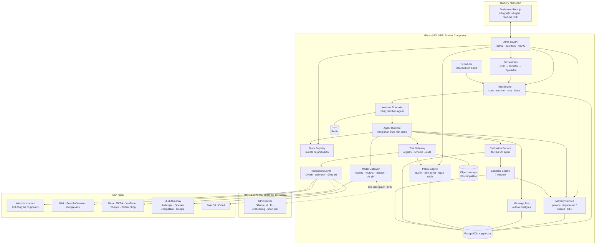
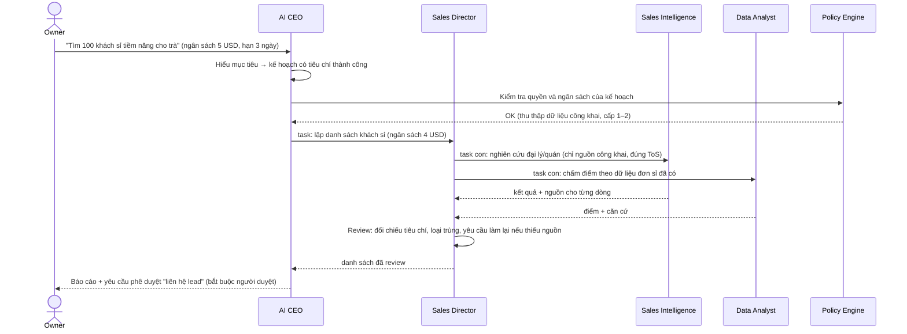

# ARCHITECTURE: AI Marketing Company Platform

> **Trạng thái:** bản thiết kế v0.1, **đang chờ Owner duyệt** (SRS §21, bước 5). Chưa có dòng mã nào được viết.
> Tài liệu gốc: `docs/SRS-v1.0.md`. Các tài liệu đi kèm: `BRAIN_SPEC.md`, `AGENT_DESIGN.md`, `DATABASE_SCHEMA.md`, `SECURITY_PLAN.md`, `TEST_PLAN.md`, `IMPLEMENTATION_PLAN.md`, `QUESTIONS_FOR_OWNER.md`.

## 1. Bối cảnh và ràng buộc thực tế

SRS mô tả nền tảng ở dạng tổng quát. Phần thiết kế này gắn nó với tình hình hiện có của xưởng:

| Thực tế | Hệ quả cho kiến trúc |
|---|---|
| Website bán hàng (repo `moctam-shop`, PHP 8 + MySQL trên **Hostinger shared hosting**) là nơi giữ dữ liệu chính thức về sản phẩm, giá, kho, đơn, khách | Nền tảng **không ghi thẳng vào CSDL website**. Mọi trao đổi đi qua API có phạm vi quyền (đã có `/api/sync/events`, `snapshot`, `catalog`, `feedback`, `drafts`) |
| Shared hosting không chạy được Docker, Postgres hay worker nền | Nền tảng phải chạy ở **máy khác** (VPS và/hoặc máy có GPU). Xem §6 và ADR-01 |
| Đã có dịch vụ AI cục bộ `ai/` và bộ não "Trưởng văn phòng" (PR #5). Hai thứ này đã chứng minh được: học từ duyệt/sửa/từ chối, nội quy, chỉ cho phép bản nháp, không nhận dữ liệu cá nhân | Đây là **thiết kế tham chiếu** được đưa sang nền tảng mới (BRAIN_SPEC §10). Dịch vụ cũ vẫn chạy cho tới khi nền tảng mới qua nghiệm thu |
| Quy mô kinh doanh nhỏ (một bên bán, một kho) | Chi phí LLM là chi phí vận hành lớn nhất, lớn hơn hạ tầng. Phải có ngân sách theo agent, theo ngày, theo nhiệm vụ ngay từ Sprint 1 |
| Pháp lý Việt Nam: Luật BVDLCN 91/2025/QH15, NĐ 356/2025/NĐ-CP, Luật TMĐT 122/2025/QH15 (repo đã áp dụng); quy định quảng cáo thực phẩm | Dữ liệu khách được **ẩn danh hóa mặc định**. Có một cửa kiểm tra tuân thủ cho nội dung quảng cáo. Thu thập lead/KOC phải đúng điều khoản nền tảng (SECURITY_PLAN §6) |

## 2. Nguyên tắc kiến trúc

1. **P1. Website là nguồn sự thật cho nghiệp vụ bán hàng.** Nền tảng chỉ đọc bản sao qua API đồng bộ và gửi *đề xuất/bản nháp* qua API. Mọi thay đổi giá, đơn, kho đều do người làm trên website.
2. **P2. Agent là dữ liệu, không phải mã.** Mỗi agent là một *brain bundle* có phiên bản (identity, policy, skills, quyền công cụ, cấu hình model, luật đánh giá) cộng với vùng nhớ riêng. Tất cả chạy trên **một runtime chung**. Thêm agent thứ 16 hay thứ 100 không cần sửa lõi (SRS AC-21).
3. **P3. Có hai cửa ngõ bắt buộc.** Mọi lời gọi LLM đi qua **Model Gateway**. Mọi tác động ra ngoài (web, API, website, gửi tin) đi qua **Tool Gateway**, nơi kiểm tra quyền, schema, timeout, ngân sách và ghi audit. Agent không cầm khóa API, không có kết nối CSDL.
4. **P4. Postgres giữ trạng thái, hàng đợi chỉ để đánh thức.** Task, message, memory, phê duyệt và audit đều nằm trong Postgres. Redis/Dramatiq chỉ báo "có việc". Nhờ vậy hệ thống khôi phục được sau khi khởi động lại, gửi lặp không gây hại (idempotent), và kiểm toán được (SRS §7, §14).
5. **P5. Đánh giá độc lập.** Agent không tự chấm để kết luận mình tiến bộ. Điểm học tập lấy từ kiểm tra tất định, phản hồi của con người và số liệu kinh doanh thật. LLM-judge chỉ là tín hiệu phụ đã hiệu chỉnh (BRAIN_SPEC §8).
6. **P6. Dữ liệu cá nhân tối thiểu.** Mặc định agent chỉ thấy `customer_key` (mã băm). Thông tin liên hệ chỉ được dùng qua công cụ có phê duyệt và không bao giờ gửi cho LLM bên ngoài nếu chưa che.
7. **P7. Nội dung bên ngoài là dữ liệu, không phải chỉ thị.** Trang web, tài liệu, bình luận và tin nhắn khách đều được gắn nhãn *không tin cậy* và xử lý theo mẫu "hai tầng" (SECURITY_PLAN §4).
8. **P8. Cô lập lỗi.** Mỗi agent có hàng đợi, ngân sách, timeout và cầu dao riêng. Một agent lỗi chỉ dừng chính nó (SRS §21.9).

## 3. Sơ đồ tổng thể

## 4. Thành phần

| Thành phần | Trách nhiệm | Không được làm |
|---|---|---|
| **API (FastAPI)** | REST `/api/v1/*` theo SRS §16, xác thực, RBAC, validate bằng Pydantic, mã lỗi ổn định, SSE cho realtime | Chứa logic nghiệp vụ của agent |
| **Orchestrator** | Nhận mục tiêu của Owner, giao cho AI CEO; quản lý cây nhiệm vụ (độ sâu, số nhánh, ngân sách thừa kế); xử lý bất đồng (SRS §6.3) | Tự quyết việc vượt quyền: những việc đó thành yêu cầu phê duyệt |
| **Task Engine** | Máy trạng thái 9 trạng thái (SRS §7), phụ thuộc, hạn chót, retry có giãn cách, timeout, khóa gửi lặp, *lease* có hạn để khôi phục sau sự cố, hủy | Giữ trạng thái chỉ trong bộ nhớ |
| **Agent Runtime** | Chạy *một bước nhận thức* (BRAIN_SPEC §4): nạp brain → truy hồi trí nhớ → lập kế hoạch → gọi công cụ → tự kiểm tra tất định → nộp kết quả → ghi trải nghiệm | Ghi thẳng vào semantic/procedural memory (chỉ được *đề xuất*) |
| **Brain Registry** | Nạp, kiểm tra schema, băm và phiên bản hóa brain bundle; so sánh phiên bản, rollback, chạy *shadow* | Cho agent tự sửa quy tắc cốt lõi |
| **Memory Service** | CRUD trí nhớ theo phạm vi, truy hồi lai (vector + từ khóa + metadata + thời gian + chủ sở hữu), ngân sách token, Row-Level Security | Trả toàn bộ trí nhớ vào ngữ cảnh |
| **Learning Engine** | 7 module theo SRS §5.2: thu thập → trích xuất → thẩm định → hợp nhất → đánh giá trải nghiệm → lên lịch học → quản lý phiên bản kiến thức | Coi nội dung web là sự thật khi chưa thẩm định |
| **Evaluation Service** | Chấm kết quả theo rubric của loại việc: kiểm tra tất định, ý kiến người duyệt, số liệu kinh doanh, LLM-judge đã hiệu chỉnh (khác họ model) | Dùng điểm do chính agent làm việc tự chấm |
| **Policy Engine** | `authorize(principal, action, resource, context)`: mặc định từ chối; 4 cấp tự chủ; danh sách việc bắt buộc người duyệt; ngân sách | Bị agent sửa (chỉ Owner sửa, có audit) |
| **Model Gateway** | Danh sách model và nhà cung cấp, định tuyến theo *hồ sơ* (vd `reasoning_high`, `writer_vi`, `cheap_classifier`, `embed_vi`), dự phòng, giới hạn tần suất, đếm token và chi phí, kiểm tra đầu ra có cấu trúc, che dữ liệu cá nhân trước khi gửi ra ngoài | Để tên nhà cung cấp xuất hiện trong code của agent |
| **Tool Gateway** | Danh sách công cụ (ID, mô tả, schema vào/ra, quyền, timeout, retry, audit); chạy công cụ nội bộ, công cụ tích hợp và công cụ MCP | Cho agent gọi HTTP tùy ý |
| **Integration Layer** | Kết nối từng nền tảng: cấu hình, OAuth, làm mới token, webhook, đồng bộ, giới hạn tần suất, trạng thái kết nối | Lưu secret trong mã hoặc trong ngữ cảnh LLM |
| **Scheduler** | Lịch theo cron cho từng agent (SRS §14), có tạm dừng, tiếp tục, chạy bù khi khởi động lại; lịch lưu trong CSDL | Hardcode giờ |
| **Message Bus** | Lưu message vào bảng (outbox) rồi phát; giao ít nhất một lần, có khóa chống trùng; 8 loại message (SRS §6.1) | Phụ thuộc Redis để giữ lịch sử |
| **Dashboard** | Các màn hình SRS §12: tổng quan, agent, bộ não, chat agent, trung tâm nhiệm vụ (Kanban và bảng), trung tâm học tập, chat công ty, phê duyệt | Gọi thẳng LLM |

## 5. Luồng chính

### 5.1. Owner giao mục tiêu, cả công ty phối hợp

### 5.2. Một bước của agent

BRAIN_SPEC §4 mô tả chi tiết. Tóm tắt:

1. Worker lấy task (có lease) và nạp brain bundle theo phiên bản ghim trong task.
2. Tạo working memory từ đầu vào và checkpoint trước đó, nếu có.
3. Truy hồi trí nhớ có ngân sách token: quy trình, kinh nghiệm tương tự, kiến thức đã kiểm chứng, tri thức chung.
4. LLM (qua Model Gateway) lập *kế hoạch có cấu trúc*. Policy Engine kiểm tra từng hành động trong kế hoạch.
5. Gọi công cụ qua Tool Gateway. Đầu ra không tin cậy được đưa qua tầng "đọc cách ly".
6. Tự kiểm tra **tất định**: đúng schema, đủ tiêu chí thành công, không có cụm từ bị cấm, số liệu khớp DB.
7. Nộp kết quả: `WAITING_REVIEW` (Director) hoặc `WAITING_APPROVAL` (Owner), hoặc `COMPLETED` nếu quyền cho phép.
8. Ghi episodic memory. Gửi đề xuất bài học vào hàng chờ thẩm định (không ghi thẳng).

### 5.3. Học từ kết quả thật

Kết quả (duyệt/sửa/từ chối, số liệu GSC/GA4/Ads, đơn hàng) → Evaluation Service gắn điểm vào `experience_records` → định kỳ, Learning Engine gom các trải nghiệm tương tự → đề xuất bài học kèm bằng chứng và mức chắc chắn → thẩm định (tự động và/hoặc Owner) → procedural/semantic memory có phiên bản. BRAIN_SPEC §7 có đủ chi tiết, gồm cả quy tắc "tương quan không phải nhân quả".

## 6. Mô hình triển khai

| Phương án | Mô tả | Ưu | Nhược | Đánh giá |
|---|---|---|---|---|
| A. Toàn bộ trên máy cá nhân có GPU | Docker Compose trên PC | Không tốn tiền thuê máy, dùng GPU trực tiếp | Máy tắt là công ty AI "nghỉ việc"; dashboard không mở được từ xa nếu không mở cổng; điện và độ ổn định | Chỉ hợp để thử nghiệm |
| **B. VPS lõi + GPU worker tùy chọn** (khuyến nghị) | Lõi (Postgres, API, dashboard, scheduler, worker) trên VPS Linux. Máy GPU chạy *GPU worker* **chủ động kết nối ra** VPS để nhận việc (embedding, phân loại, soạn nháp rẻ) | Chạy 24/7, không cần mở cổng vào nhà, máy GPU tắt thì tự chuyển sang model đám mây | Tốn tiền thuê VPS, phải quản trị thêm một máy | **Đề xuất** |
| C. Toàn bộ trên đám mây (cả GPU) | VPS + GPU thuê theo giờ | Linh hoạt | Chi phí GPU đám mây cao so với quy mô xưởng | Chưa cần |

Cấu hình VPS tối thiểu dự kiến cho 15 agent: 4 vCPU, 8 GB RAM, 80 GB SSD. Nên dùng 16 GB RAM nếu tự chạy công cụ quan sát nặng (ADR-08). Khi mở rộng tới 100 agent, nút thắt là **hạn mức và chi phí của LLM**, không phải CPU (xem §9).

GPU worker chỉ cần: Docker, driver GPU, Ollama hoặc vLLM, và một token worker có phạm vi hẹp. Worker *kéo* việc qua HTTPS (long-poll). Không có cổng nào phải mở vào mạng nhà.

## 7. Quyết định kiến trúc (ADR)

Mỗi quyết định nêu: lý do, ưu điểm, nhược điểm, chi phí vận hành, khả năng mở rộng (theo yêu cầu SRS). Các mục đánh dấu ⚠ **khác với gợi ý trong SRS** và cần Owner duyệt riêng.

### ADR-01. Triển khai VPS lõi + GPU worker kết nối ra
- **Lý do:** shared hosting không chạy được Docker, và máy cá nhân có thể tắt. SRS yêu cầu chạy theo lịch 08:00–18:00, dashboard realtime, khôi phục sau khi khởi động lại.
- **Ưu:** chạy liên tục; GPU là tài nguyên "có thì tốt", tắt máy không ảnh hưởng tính đúng đắn; không mở cổng vào mạng nhà.
- **Nhược:** thêm chi phí thuê VPS; cần sao lưu VPS; độ trễ VPS ↔ GPU cao hơn so với chạy cùng máy.
- **Chi phí:** một VPS cỡ trên, tính theo báo giá nhà cung cấp mà Owner chọn. Điện cho máy GPU khi bật.
- **Mở rộng:** thêm GPU worker hay worker CPU chỉ là chạy thêm container trỏ về cùng hàng đợi. Có thể chuyển sang Kubernetes sau mà không đổi mã.

### ADR-02. Backend Python 3.12 + FastAPI + SQLAlchemy 2 + Alembic + Pydantic v2
- **Lý do:** đúng SRS; hệ sinh thái AI của Python mạnh nhất; đội đã có mã Python (`ai/`).
- **Ưu:** async tốt cho tác vụ chờ I/O (LLM, API); Pydantic dùng chung cho validate API, schema công cụ và đầu ra có cấu trúc của LLM.
- **Nhược:** phải giữ kỷ luật async (không chặn event loop); kiểu dữ liệu yếu hơn TypeScript ở biên front-end, nên cần sinh client TS từ OpenAPI.
- **Chi phí:** không phát sinh.
- **Mở rộng:** API không giữ trạng thái, nên tăng số bản chạy theo chiều ngang được.

### ADR-03. PostgreSQL 16+ với pgvector (HNSW), một CSDL cho cả quan hệ và vector
- **Lý do:** SRS chọn sẵn. Trí nhớ cần *vừa* lọc quyền/metadata/thời gian *vừa* tìm theo nghĩa. Làm cả hai trong một câu SQL vừa đúng vừa nhanh hơn so với ghép hai hệ thống.
- **Ưu:** Row-Level Security thực thi quyền trí nhớ ngay tại CSDL; giao dịch ACID cho task, phê duyệt và audit; một hệ thống để sao lưu.
- **Nhược:** vector hàng chục triệu bản ghi thì cần tinh chỉnh (HNSW `m`, `ef_search`, phân vùng). Quy mô của xưởng còn xa ngưỡng đó.
- **Chi phí:** nằm trong VPS.
- **Mở rộng:** 100 agent × vài chục nghìn trí nhớ ≈ vài triệu vector: HNSW chịu được trên một máy. Khi lớn hơn thì phân vùng theo `owner_scope` hoặc tách read-replica.

### ADR-04. Task Engine trên Postgres + Dramatiq/Redis (không dùng Celery)
- **Lý do:** SRS cho chọn Celery hoặc Dramatiq. Trạng thái việc phải sống sót qua sự cố, nên nguồn sự thật là bảng `tasks`. Hàng đợi chỉ mang `task_id`.
- **Ưu:** Dramatiq gọn, mặc định xác nhận sau khi xử lý xong (an toàn khi worker chết), cấu hình retry rõ ràng. Lease + `SELECT … FOR UPDATE SKIP LOCKED` cho phép quét lại việc bị bỏ dở khi khởi động.
- **Nhược:** hệ sinh thái nhỏ hơn Celery; ít công cụ giám sát dựng sẵn, nên dashboard tự hiển thị trạng thái hàng đợi.
- **Chi phí:** Redis nhỏ (vài trăm MB RAM).
- **Mở rộng:** hàng đợi theo agent hoặc nhóm agent, đặt giới hạn đồng thời cho từng hàng. Chạy thêm worker theo chiều ngang.

### ADR-05 ⚠. Tự xây phần điều phối tổ chức; LangGraph là bộ chạy *tùy chọn* bên trong một agent
- **Lý do:** SRS ghi LangGraph. Nhưng phần khó nhất ở đây là *điều phối cấp tổ chức*: cây nhiệm vụ nhiều agent, phê duyệt của người kéo dài nhiều ngày, ngân sách, khôi phục, audit. Phần này phải nằm trong Task Engine và Postgres (P4). Nếu dùng LangGraph cho cả việc này thì sẽ có **hai nguồn trạng thái** (checkpoint của LangGraph và bảng `tasks`).
- **Đề xuất:** vòng nhận thức của agent được định nghĩa qua interface `ReasoningEngine`. Bản mặc định là vòng lặp nội bộ nhỏ, dễ kiểm thử. Có thêm adapter LangGraph cho những agent cần đồ thị suy luận phức tạp (vd Growth Director thiết kế thí nghiệm). Owner có thể bật LangGraph theo từng agent mà không đổi lõi.
- **Ưu:** một nguồn sự thật; dễ kiểm thử bằng model giả; không phụ thuộc vào thay đổi API của thư viện.
- **Nhược:** tự viết vòng lặp (khoảng vài trăm dòng); bỏ lỡ một số tiện ích dựng sẵn (trực quan hóa đồ thị).
- **Chi phí:** không phát sinh.
- **Mở rộng:** thêm kiểu suy luận mới bằng cách thêm một bản cài `ReasoningEngine`.
- **Phương án theo đúng SRS:** dùng LangGraph làm bộ chạy chính và lưu checkpoint vào Postgres. Có thể làm được, nhưng phải viết thêm lớp đồng bộ hai nguồn trạng thái. Xem câu hỏi Q-T1.

### ADR-06. Model Gateway tự xây, mỏng, gồm 3 giao thức
- **Lý do:** SRS §8 yêu cầu registry, định tuyến, dự phòng, ngân sách, kiểm tra đầu ra có cấu trúc và che dữ liệu, *gắn chặt với CSDL* của chúng ta. Ba giao thức phủ được mọi nhà cung cấp trong SRS:
  - Anthropic Messages;
  - OpenAI-compatible (gồm vLLM, Ollama và nhiều nhà cung cấp khác);
  - Google.
- **Ưu:** kiểm soát hoàn toàn việc đếm chi phí và che dữ liệu; agent chỉ gọi *hồ sơ model* (`reasoning_high`…), đổi nhà cung cấp chỉ cần sửa registry (AC-22).
- **Nhược:** tự bảo trì adapter khi nhà cung cấp đổi API.
- **Phương án khác:** LiteLLM (phủ hơn 100 nhà cung cấp, nhưng phụ thuộc lớn và vẫn phải tự làm ngân sách và che dữ liệu). Có thể thêm làm adapter thứ 4 nếu cần.
- **Chi phí:** không phát sinh. Chi phí LLM xem §8.
- **Mở rộng:** giới hạn tần suất theo nhà cung cấp và theo agent; xếp hàng ưu tiên khi chạm hạn mức.

### ADR-07. Frontend Next.js (App Router) + TypeScript + Tailwind; realtime bằng SSE
- **Lý do:** đúng SRS. Realtime chỉ cần một chiều (máy chủ → trình duyệt), nên SSE đơn giản hơn WebSocket và đi qua proxy dễ hơn.
- **Ưu:** sinh client có kiểu từ OpenAPI; giao diện tiếng Việt mặc định (i18n); có chế độ sáng/tối.
- **Nhược:** thêm một runtime Node.js trên VPS.
- **Chi phí:** khoảng 200–400 MB RAM.
- **Mở rộng:** dashboard không giữ trạng thái.

### ADR-08 ⚠. Quan sát: log JSON + OpenTelemetry + bảng `model_usage` của chính hệ thống; Langfuse để giai đoạn sau
- **Lý do:** bản tự host Langfuse hiện kéo theo nhiều dịch vụ phụ (theo tài liệu v3: ClickHouse, Redis, object storage), nặng so với một VPS 8 GB. Các con số SRS cần (chi phí, token, độ trễ, lỗi theo agent) đã nằm trong bảng của chúng ta.
- **Ưu:** nhẹ; dữ liệu theo dõi có kiểm soát quyền như mọi dữ liệu khác.
- **Nhược:** thiếu giao diện so sánh prompt/trace dựng sẵn. Cần thì bật Langfuse (tự host hoặc bản đám mây) qua exporter OpenTelemetry.
- **Chi phí:** gần 0 so với tự host Langfuse.
- **Mở rộng:** đổi đích xuất OpenTelemetry mà không sửa mã.

### ADR-09 ⚠. n8n là công cụ tùy chọn từ Sprint 8, không phải phần lõi
- **Lý do:** n8n trùng vai trò với Integration Layer và Automation Agent. Chạy n8n tức là thêm một nơi giữ secret và một hệ thống quyền nữa. Giấy phép n8n là "Sustainable Use License": dùng nội bộ được, nhưng không phải mã nguồn mở theo nghĩa OSI, cần Owner chấp nhận.
- **Ưu khi bật:** Owner tự kéo thả quy trình không cần lập trình.
- **Nhược:** phải đồng bộ quyền và audit hai nơi.
- **Cách tích hợp:** n8n được gọi như một *công cụ* qua webhook có chữ ký, nằm dưới Policy Engine như mọi công cụ khác.

### ADR-10. Object storage qua giao diện S3; bản phát triển dùng thư mục cục bộ
- **Lý do:** ảnh, video, tài liệu nghiên cứu, bản sao lưu.
- **Lưu ý:** cách phát hành bản cộng đồng của MinIO đã thay đổi trong năm 2025. Cần kiểm tra lại trước khi chọn. Phương án khác: dịch vụ S3-compatible thuê ngoài (Cloudflare R2, Backblaze B2…), hoặc Garage/SeaweedFS tự host.
- **Mở rộng:** đổi nhà cung cấp chỉ bằng cấu hình.

### ADR-11. "Brain as code": brain bundle dạng YAML trong git, registry phiên bản trong CSDL
- **Lý do:** SRS §4.5 yêu cầu mỗi lần đổi bộ não ghi lại nội dung, nguồn, người đề xuất, kết quả kiểm tra, phiên bản trước, rollback. Git cho sẵn diff và lịch sử. CSDL ghi phiên bản nào *đang chạy* cho agent nào.
- **Ưu:** review được bằng PR; phiên bản cũ không bao giờ bị sửa (immutable); chạy được *shadow* (bản mới chạy song song, không giao kết quả).
- **Nhược:** Owner sửa trên dashboard thì hệ thống phải tạo commit hoặc bản ghi phiên bản tương đương. Thiết kế: dashboard tạo `improvement_proposal`; khi được duyệt thì ghi phiên bản mới vào CSDL và xuất ra YAML.
- **Mở rộng:** 100 agent = 100 thư mục bundle, có kế thừa từ *mẫu theo phòng ban* để không lặp lại.

### ADR-12. Truy hồi trí nhớ lai, chuẩn hóa tiếng Việt
- **Lý do:** tiếng Việt có/không dấu, viết tắt ("sp", "ship", "cf"). Repo hiện có `textnorm.fold`/BM25 đã hiệu chỉnh và khớp giữa PHP và Python. Postgres không có bộ tách từ tiếng Việt.
- **Thiết kế:**
  - Tìm từ khóa: cột `search_text` đã bỏ dấu + `tsvector` cấu hình `simple` + `pg_trgm`.
  - Tìm vector: embedding đa ngôn ngữ, chạy cục bộ trên GPU nếu có (vd họ BGE-M3), dự phòng bằng embedding đám mây.
  - Ghép thứ hạng bằng Reciprocal Rank Fusion, rồi nhân trọng số thời gian, độ tin cậy và trạng thái xác minh.
- **Mở rộng:** đổi model embedding → job nhúng lại theo lô. Mỗi vector lưu `embedding_model_id` nên chạy song song được hai model trong lúc chuyển.

### ADR-13. Danh tính: người dùng và agent là hai loại principal tách biệt
- Người dùng (Owner, nhân viên): đăng nhập, phiên HttpOnly, 2FA cho Owner, RBAC.
- Agent: *service principal* do hệ thống cấp, không đăng nhập. Mọi quyền đi qua Policy Engine. Agent không tự nâng quyền được (SRS §15).

### ADR-14. Tích hợp website moctam: dùng lại API đồng bộ, bổ sung endpoint có phạm vi khi cần
- Đọc: `events`/`snapshot` (đơn tối thiểu, `customer_key`), `catalog`, `feedback`.
- Ghi: `drafts` (FAQ, blog, mua kèm, danh sách chăm sóc; mọi thứ chờ duyệt).
- Bổ sung dự kiến (Sprint 8): endpoint tổng hợp số liệu (doanh thu và lợi nhuận theo ngày/kênh, *không có dòng chi tiết khách*); kiểu bản nháp mới (`campaign_proposal`, `landing_suggestion`); `office_report`.
- Giá vốn chỉ đi qua khóa có phạm vi `finance:read`, cấp cho Data Analyst (SRS §10).

## 8. Chi phí vận hành dự kiến

### 8.1. Hạ tầng
| Hạng mục | Ghi chú |
|---|---|
| VPS lõi 4 vCPU / 8–16 GB | Theo báo giá nhà cung cấp Owner chọn |
| Object storage | Vài GB đầu tiên thường rẻ hoặc miễn phí; video làm tăng nhanh |
| Sao lưu ngoài máy | Bắt buộc (SECURITY_PLAN §8) |
| Máy GPU | Đã có (giả định). Tốn điện khi bật |

### 8.2. LLM: chi phí chính
Công thức nằm trong Model Gateway: `chi_phí = Σ (token_vào × giá_vào + token_ra × giá_ra)` theo từng model trong registry. Giá **không hardcode**; Owner nhập theo bảng giá hiện hành.

Ước lượng khối lượng token khi chạy lịch mặc định SRS §14 với 15 agent (để lập ngân sách, **cần đo lại sau Sprint 4**):

| Nhóm | Số agent | Lượt gọi / ngày / agent | Token vào / lượt | Token ra / lượt | Token / ngày |
|---|---|---|---|---|---|
| CEO + 3 Director (lập kế hoạch, review) | 4 | 10 | 12.000 | 1.500 | ~540.000 |
| Chuyên viên soạn nội dung (SEO, Content, Social, Creative, Ads) | 5 | 15 | 8.000 | 2.000 | ~750.000 |
| Chuyên viên phân tích (Customer, Affiliate, SI, CRO, Data, Automation) | 6 | 8 | 10.000 | 1.000 | ~530.000 |
| **Tổng** | 15 | | | | **~1,8 triệu token/ngày** |

Ví dụ minh họa, **giá giả định không phải bảng giá thật**: nếu 70% token đi qua model tầm trung giá X USD/1M token và 30% qua model rẻ giá X/5, thì chi phí/ngày ≈ 1,8 × (0,7 + 0,06) × X ≈ 1,4·X USD. Owner đặt **trần ngân sách ngày** (mặc định đề xuất: một con số Owner chọn ở Q-B1). Khi chạm trần, Model Gateway hạ việc ưu tiên thấp xuống model rẻ, hoặc hoãn sang hôm sau.

Các cách giảm chi phí đã có sẵn trong thiết kế:
- "Bộ nhớ trước, LLM sau" (đã chứng minh ở dịch vụ hiện tại);
- tóm tắt ngữ cảnh có ngân sách;
- model rẻ hoặc chạy cục bộ cho phân loại, embedding, che dữ liệu;
- prompt caching của nhà cung cấp, nếu có;
- lịch chạy theo *tín hiệu* (như bộ não Trưởng văn phòng) thay vì chạy mọi agent mỗi giờ.

## 9. Mở rộng lên 100 agent

| Khía cạnh | 15 agent | 100 agent | Biện pháp |
|---|---|---|---|
| Thêm agent | Bundle + đăng ký | Như cũ | Mẫu theo phòng ban, kiểm tra schema bundle trong CI, không sửa lõi (AC-21) |
| Điều phối | CEO → 3 Director | CEO → ~8 Director → trưởng nhóm | Cây có độ sâu tối đa (mặc định 4), số nhánh tối đa mỗi nút, ngân sách thừa kế. CEO chỉ thấy báo cáo đã tổng hợp |
| LLM | ~1,8M token/ngày | ~10–15M token/ngày nếu không tối ưu | Tạo việc theo tín hiệu (không chạy lịch dày cho mọi agent), mỗi agent có ngân sách, định tuyến sang model rẻ. **Đây là nút thắt chính** |
| CSDL | Nhỏ | Vài triệu vector, vài chục triệu dòng log | HNSW, phân vùng `task_logs` và `model_usage` theo tháng, chính sách giữ dữ liệu |
| Worker | 2–4 worker | 10–30 worker | Mở rộng ngang; giới hạn đồng thời theo hàng đợi |
| Message bus | Vài nghìn tin/ngày | Vài trăm nghìn tin/ngày | Outbox Postgres chịu được; nếu cần thì chuyển sang Redis Streams mà không đổi API |
| Con người | 1 Owner duyệt | Không thể duyệt từng việc | Ủy quyền theo ngưỡng (cấp 3–4 cho việc rủi ro thấp đã có thành tích), duyệt theo lô, Director review thay |

**Giới hạn thực tế:** ở quy mô 100 agent, thứ cạn trước là *sức chú ý của Owner*. Vì vậy thiết kế đặt nặng việc tổng hợp, ủy quyền có điều kiện và "sức duyệt" (đã có trong bộ não hiện tại: `max_pending_review`).

## 10. Rủi ro kỹ thuật chính

| Mã | Rủi ro | Mức | Giảm thiểu |
|---|---|---|---|
| R1 | Chi phí LLM vượt kế hoạch | Cao | Ngân sách nhiều tầng, cầu dao chi phí, đo thật từ Sprint 4 |
| R2 | API nền tảng (TikTok, Shopee, Meta, Zalo) đòi duyệt ứng dụng hoặc giới hạn tính năng | Cao | Kiểm tra điều kiện từng tích hợp trước Sprint 8 (Q-I*). Tích hợp chưa có thì hiển thị "chưa kết nối", **không giả lập** |
| R3 | Prompt injection từ nội dung web/khách | Cao | Đọc cách ly, công cụ rủi ro cao luôn cần người duyệt, kiểm thử tấn công (TEST_PLAN ST-*) |
| R4 | Vi phạm pháp lý dữ liệu cá nhân hoặc quảng cáo thực phẩm | Cao | Ẩn danh mặc định, cửa kiểm tra tuân thủ, luật sư rà soát (Q-L*) |
| R5 | Agent "học sai" từ tương quan giả | Trung bình | Thang bằng chứng, holdout/A-B, Owner duyệt bài học quy trình (BRAIN_SPEC §7) |
| R6 | Chất lượng model cục bộ kém với tiếng Việt marketing | Trung bình | Model cục bộ chỉ dùng cho việc phụ (embedding, phân loại). Đánh giá trên bộ test tiếng Việt trước khi giao việc viết |
| R7 | Phạm vi SRS rất lớn so với nguồn lực | Cao | Vertical slice sớm (IMPLEMENTATION_PLAN), mỗi Sprint có tiêu chí thoát đo được |
| R8 | Hai hệ thống AI (cũ và mới) cùng gửi bản nháp | Thấp | Tiền tố `client_ref` riêng, tắt dần từng tác nhân cũ khi tác nhân mới qua nghiệm thu |
