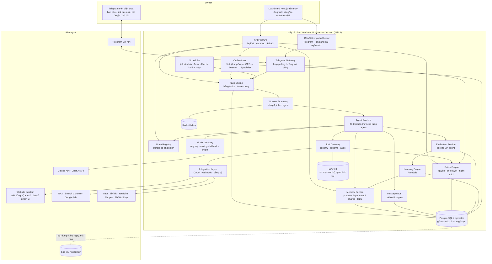
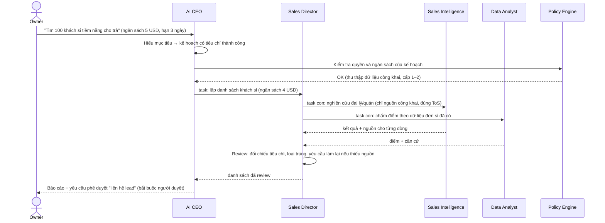

# ARCHITECTURE: AI Marketing Company Platform

> **Trạng thái:** bản thiết kế **v0.2** (26/11/2026), đã cập nhật theo câu trả lời của Owner (`DECISIONS.md`), **vẫn chờ Owner ghi "duyệt kiến trúc"** (SRS §21, bước 5). Chưa có dòng mã nào được viết.
>
> Thay đổi chính so với v0.1:
> - chạy trên **máy cá nhân Windows 11**, không thuê VPS;
> - **LangGraph** là bộ chạy luồng công việc;
> - **Claude + ChatGPT**;
> - **Telegram** là kênh của Owner;
> - **AI tự xuất bản** FAQ và blog, có 5 lớp chặn;
> - chi phí tính theo **bảng giá thật**, trần **50 USD/tháng**;
> - máy: i5-11400F, **RX 560, 16 GB RAM**, nên không chạy LLM cục bộ;
> - **lịch đăng bài theo giờ vàng**, tăng dần số bài (ADR-16);
> - Owner **tự cài đặt Telegram trong dashboard** (ADR-15).
> Tài liệu gốc: `docs/SRS-v1.0.md`. Các tài liệu đi kèm: `BRAIN_SPEC.md`, `AGENT_DESIGN.md`, `DATABASE_SCHEMA.md`, `SECURITY_PLAN.md`, `TEST_PLAN.md`, `IMPLEMENTATION_PLAN.md`, `QUESTIONS_FOR_OWNER.md`.

## 1. Bối cảnh và ràng buộc thực tế

SRS mô tả nền tảng ở dạng tổng quát. Phần thiết kế này gắn nó với tình hình hiện có của xưởng:

| Thực tế | Hệ quả cho kiến trúc |
|---|---|
| Website bán hàng (repo `moctam-shop`, PHP 8 + MySQL trên **Hostinger shared hosting**) là nơi giữ dữ liệu chính thức về sản phẩm, giá, kho, đơn, khách | Nền tảng **không ghi thẳng vào CSDL website**. Mọi trao đổi đi qua API có phạm vi quyền (đã có `/api/sync/events`, `snapshot`, `catalog`, `feedback`, `drafts`) |
| Shared hosting không chạy được Docker, Postgres hay worker nền | Owner chọn chạy trên **máy cá nhân Windows 11**: i5-11400F (6 nhân 12 luồng), **AMD Radeon RX 560**, **16 GB RAM**. Mọi LLM chạy trên đám mây; cả hệ thống phải gọn trong khoảng 6 GB RAM (§6, ADR-01) |
| Owner muốn AI **tự xuất bản** và **báo qua Telegram** | Website thêm API xuất bản/gỡ bài dùng khóa riêng (ADR-16). Telegram là kênh điều hành chính của Owner (ADR-15) |
| Đã có dịch vụ AI cục bộ `ai/` và bộ não "Trưởng văn phòng" (PR #5). Hai thứ này đã chứng minh được: học từ duyệt/sửa/từ chối, nội quy, chỉ cho phép bản nháp, không nhận dữ liệu cá nhân | Đây là **thiết kế tham chiếu** được đưa sang nền tảng mới (BRAIN_SPEC §10). Dịch vụ cũ vẫn chạy cho tới khi nền tảng mới qua nghiệm thu |
| Quy mô kinh doanh nhỏ; trần LLM **50 USD/tháng** (Owner xác nhận) | Chi phí LLM là chi phí vận hành lớn nhất. Phải có ngân sách theo agent, theo ngày, theo nhiệm vụ ngay từ Sprint 1, và định tuyến phần lớn việc sang model rẻ (§8) |
| Owner quyết định **bỏ qua phần pháp lý** (26/11/2026) | Không có bước rà soát pháp lý trong kế hoạch. Vẫn giữ: dữ liệu khách **ẩn danh mặc định**; **Content Gate** chống đăng thông tin sai về sản phẩm; không thu thập dữ liệu tự động trái điều khoản nền tảng (để tránh bị khóa tài khoản) (SECURITY_PLAN §6) |

## 2. Nguyên tắc kiến trúc

1. **P1. Website là nguồn sự thật cho nghiệp vụ bán hàng.** Nền tảng chỉ đọc bản sao qua API đồng bộ. Nó gửi bản nháp, và từ v0.2 được **xuất bản hoặc gỡ FAQ/blog** qua API dùng khóa riêng, có hạn mức và audit (ADR-16). Mọi thay đổi giá, đơn, kho, khuyến mãi đều do người làm trên website.
2. **P2. Agent là dữ liệu, không phải mã.** Mỗi agent là một *brain bundle* có phiên bản (identity, policy, skills, quyền công cụ, cấu hình model, luật đánh giá) cộng với vùng nhớ riêng. Tất cả chạy trên **một runtime chung**. Thêm agent thứ 16 hay thứ 100 không cần sửa lõi (SRS AC-21).
3. **P3. Có hai cửa ngõ bắt buộc.** Mọi lời gọi LLM đi qua **Model Gateway**. Mọi tác động ra ngoài (web, API, website, gửi tin) đi qua **Tool Gateway**, nơi kiểm tra quyền, schema, timeout, ngân sách và ghi audit. Agent không cầm khóa API, không có kết nối CSDL.
4. **P4. Postgres giữ trạng thái, hàng đợi chỉ để đánh thức.** Task, message, memory, phê duyệt và audit đều nằm trong Postgres. Redis/Dramatiq chỉ báo "có việc". Nhờ vậy hệ thống khôi phục được sau khi khởi động lại, gửi lặp không gây hại (idempotent), và kiểm toán được (SRS §7, §14).
5. **P5. Đánh giá độc lập.** Agent không tự chấm để kết luận mình tiến bộ. Điểm học tập lấy từ kiểm tra tất định, phản hồi của con người và số liệu kinh doanh thật. LLM-judge chỉ là tín hiệu phụ đã hiệu chỉnh (BRAIN_SPEC §8).
6. **P6. Dữ liệu cá nhân tối thiểu.** Mặc định agent chỉ thấy `customer_key` (mã băm). Thông tin liên hệ chỉ được dùng qua công cụ có phê duyệt và không bao giờ gửi cho LLM bên ngoài nếu chưa che.
7. **P7. Nội dung bên ngoài là dữ liệu, không phải chỉ thị.** Trang web, tài liệu, bình luận và tin nhắn khách đều được gắn nhãn *không tin cậy* và xử lý theo mẫu "hai tầng" (SECURITY_PLAN §4).
8. **P8. Cô lập lỗi.** Mỗi agent có hàng đợi, ngân sách, timeout và cầu dao riêng. Một agent lỗi chỉ dừng chính nó (SRS §21.9).

## 3. Sơ đồ tổng thể

## 4. Thành phần

| Thành phần | Trách nhiệm | Không được làm |
|---|---|---|
| **API (FastAPI)** | REST `/api/v1/*` theo SRS §16, xác thực, RBAC, validate bằng Pydantic, mã lỗi ổn định, SSE cho realtime | Chứa logic nghiệp vụ của agent |
| **Orchestrator** | Chạy các **đồ thị LangGraph** cấp tổ chức: nhận mục tiêu của Owner, giao cho AI CEO; quản lý cây nhiệm vụ (độ sâu, số nhánh, ngân sách thừa kế); xử lý bất đồng (SRS §6.3) | Tự quyết việc vượt quyền: những việc đó thành `interrupt()` chờ duyệt |
| **Task Engine** | Máy trạng thái 9 trạng thái (SRS §7), phụ thuộc, hạn chót, retry có giãn cách, timeout, khóa gửi lặp, *lease* có hạn để khôi phục sau sự cố, hủy | Giữ trạng thái chỉ trong bộ nhớ |
| **Agent Runtime** | Chạy *một bước nhận thức* (BRAIN_SPEC §4): nạp brain → truy hồi trí nhớ → lập kế hoạch → gọi công cụ → tự kiểm tra tất định → nộp kết quả → ghi trải nghiệm | Ghi thẳng vào semantic/procedural memory (chỉ được *đề xuất*) |
| **Brain Registry** | Nạp, kiểm tra schema, băm và phiên bản hóa brain bundle; so sánh phiên bản, rollback, chạy *shadow* | Cho agent tự sửa quy tắc cốt lõi |
| **Memory Service** | CRUD trí nhớ theo phạm vi, truy hồi lai (vector + từ khóa + metadata + thời gian + chủ sở hữu), ngân sách token, Row-Level Security | Trả toàn bộ trí nhớ vào ngữ cảnh |
| **Learning Engine** | 7 module theo SRS §5.2: thu thập → trích xuất → thẩm định → hợp nhất → đánh giá trải nghiệm → lên lịch học → quản lý phiên bản kiến thức | Coi nội dung web là sự thật khi chưa thẩm định |
| **Evaluation Service** | Chấm kết quả theo rubric của loại việc: kiểm tra tất định, ý kiến người duyệt, số liệu kinh doanh, LLM-judge đã hiệu chỉnh (khác họ model) | Dùng điểm do chính agent làm việc tự chấm |
| **Policy Engine** | `authorize(principal, action, resource, context)`: mặc định từ chối; 4 cấp tự chủ; danh sách việc bắt buộc người duyệt; ngân sách | Bị agent sửa (chỉ Owner sửa, có audit) |
| **Model Gateway** | Danh sách model và nhà cung cấp, định tuyến theo *hồ sơ* (vd `reasoning_high`, `writer_vi`, `cheap_classifier`, `embed_vi`), dự phòng, giới hạn tần suất, đếm token và chi phí, kiểm tra đầu ra có cấu trúc, che dữ liệu cá nhân trước khi gửi ra ngoài | Để tên nhà cung cấp xuất hiện trong code của agent |
| **Tool Gateway** | Danh sách công cụ (ID, mô tả, schema vào/ra, quyền, timeout, retry, audit); chạy công cụ nội bộ, công cụ tích hợp và công cụ MCP | Cho agent gọi HTTP tùy ý |
| **Integration Layer** | Kết nối từng nền tảng: cấu hình, OAuth, làm mới token, webhook, đồng bộ, giới hạn tần suất, trạng thái kết nối | Lưu secret trong mã hoặc trong ngữ cảnh LLM |
| **Scheduler** | Lịch theo cron cho từng agent (SRS §14), có tạm dừng, tiếp tục, chạy bù khi khởi động lại; lịch lưu trong CSDL | Hardcode giờ |
| **Message Bus** | Lưu message vào bảng (outbox) rồi phát; giao ít nhất một lần, có khóa chống trùng; 8 loại message (SRS §6.1) | Phụ thuộc Redis để giữ lịch sử |
| **Telegram Gateway** | Bot Telegram của Owner (ADR-15): gửi báo cáo 18:00, cảnh báo, link bài vừa xuất bản; nhận nút *Duyệt / Từ chối / Gỡ bài / Góp ý*, lệnh `/baocao`, `/chiphi`, `/tamdung`, `/tieptuc`; kiểm tra chat ID và chữ ký của nút | Gửi dữ liệu cá nhân của khách; duyệt việc rủi ro cao (những việc đó cần dashboard + 2FA) |
| **Dashboard** | **Màn hình "Diễn biến trực tiếp"** (Owner yêu cầu 26/11; bản mẫu đã chạy ở `ai/xuong_ai/monitor.py`): làn hoạt động theo agent và phòng ban, nút đồ thị LangGraph đang chạy, việc chờ + lý do, việc cần Owner, dòng sự kiện realtime (SSE), chi phí theo agent. Cộng các màn hình SRS §12: tổng quan, agent, bộ não, chat agent, trung tâm nhiệm vụ (Kanban và bảng), trung tâm học tập, chat công ty, phê duyệt | Gọi thẳng LLM |

## 5. Luồng chính

### 5.1. Owner giao mục tiêu, cả công ty phối hợp

### 5.2. Một bước của agent

BRAIN_SPEC §4 mô tả chi tiết. Tóm tắt:

1. Worker lấy task (có lease) và nạp brain bundle theo phiên bản ghim trong task.
2. Tạo working memory từ đầu vào và checkpoint trước đó, nếu có.
3. Truy hồi trí nhớ có ngân sách token: quy trình, kinh nghiệm tương tự, kiến thức đã kiểm chứng, tri thức chung.
4. LLM (qua Model Gateway) lập *kế hoạch có cấu trúc*. Policy Engine kiểm tra từng hành động trong kế hoạch.
5. Gọi công cụ qua Tool Gateway. Đầu ra không tin cậy được đưa qua tầng "đọc cách ly".
6. Tự kiểm tra **tất định**: đúng schema, đủ tiêu chí thành công, không có cụm từ bị cấm, số liệu khớp DB.
7. Nộp kết quả: `WAITING_REVIEW` (Director), `WAITING_APPROVAL` (Owner, qua Telegram hoặc dashboard), hoặc `COMPLETED` nếu quyền cho phép. Với FAQ/blog đủ điều kiện tự xuất bản: gọi `site.publish` rồi báo link qua Telegram (ADR-16).
8. Ghi episodic memory. Gửi đề xuất bài học vào hàng chờ thẩm định (không ghi thẳng).

### 5.3. Học từ kết quả thật

Kết quả (duyệt/sửa/từ chối, số liệu GSC/GA4/Ads, đơn hàng) → Evaluation Service gắn điểm vào `experience_records` → định kỳ, Learning Engine gom các trải nghiệm tương tự → đề xuất bài học kèm bằng chứng và mức chắc chắn → thẩm định (tự động và/hoặc Owner) → procedural/semantic memory có phiên bản. BRAIN_SPEC §7 có đủ chi tiết, gồm cả quy tắc "tương quan không phải nhân quả".

## 6. Mô hình triển khai (v0.2: máy cá nhân Windows 11)

Owner chọn chạy toàn bộ trên máy cá nhân (Q-A2, Q-A3). Đây cũng là "Local" trong mô hình *Hybrid Local + Cloud AI API* của SRS: máy nhà chạy phần mềm, còn trí tuệ chính gọi Claude/OpenAI trên đám mây.

| Thành phần | Chạy ở đâu trên máy |
|---|---|
| Postgres 16/17 + pgvector, Redis/Valkey | Container Linux trong Docker Desktop (backend WSL2), dữ liệu nằm trên **volume WSL2** (nhanh hơn ổ Windows mount vào) |
| API, worker, scheduler, Telegram Gateway | Container Python |
| Dashboard Next.js | Container Node; mở `http://localhost:3000` trên máy. Xem từ xa là tùy chọn (Tailscale) |
| LLM cục bộ | **Không dùng.** Card RX 560 (kiến trúc Polaris, 2–4 GB VRAM) không nằm trong danh sách GPU AMD mà Ollama hỗ trợ qua ROCm. Đường Vulkan còn thử nghiệm, và VRAM quá nhỏ để có ích. Embedding dùng API OpenAI (rẻ, không tốn RAM máy) |
| Lưu tệp (ảnh, video, tài liệu) | Thư mục trên ổ D: hoặc volume, qua giao diện S3 (ADR-10) |

**Máy của Owner: i5-11400F, RX 560, 16 GB RAM. Ngân sách RAM (bắt buộc):**

| Thành phần | RAM tối đa |
|---|---|
| Windows 11 + trình duyệt + phần mềm khác của Owner | ~8 GB (không đụng tới) |
| WSL2 (đặt trong `.wslconfig`: `memory=6GB`, `swap=4GB`) | **6 GB** cho cả hệ thống |
| ↳ Postgres + pgvector (`shared_buffers=512MB`) | ~1 GB |
| ↳ Redis/Valkey | ~150 MB |
| ↳ API + 2 worker + scheduler + Telegram + worker trí nhớ (Python, LangGraph) | ~2 GB (worker trí nhớ đo được ~90 MB, Sprint 3) |
| ↳ Dashboard Next.js (bản build production, không chạy dev server) | ~400 MB |
| ↳ Dự phòng | ~2 GB |

- Số worker mặc định là 2. Mỗi worker chạy nhiều agent theo kiểu async: agent chủ yếu chờ API, nên 2 worker đủ cho 15 agent.
- **Nâng RAM lên 32 GB** là việc nên làm khi vượt 15 agent, hoặc khi Owner hay mở nhiều phần mềm nặng cùng lúc. Chi phí thấp và hiệu quả hơn mọi tối ưu khác.
- **Ổ đĩa:** SSD còn trống ≥ 100 GB.
- **CPU:** i5-11400F đủ cho 15 agent.

**Vì máy cá nhân có thể tắt, ngủ hoặc tự khởi động lại để cập nhật Windows:**
- Docker Desktop đặt "Start when you sign in"; container `restart: unless-stopped`; Windows tự đăng nhập hoặc chạy Docker như dịch vụ.
- Tắt chế độ ngủ (Sleep = Never) khi cắm điện. Đặt "Active hours" của Windows Update trùng giờ làm việc.
- Khi bật lại, Scheduler **làm bù** các lịch bị lỡ (không làm bù quá 24 giờ), và Telegram báo: "Máy đã tắt từ … đến …, đã làm bù N việc".
- Task đang chạy dở được tiếp tục từ checkpoint của LangGraph (ADR-05).
- **Website vẫn bán bình thường** khi máy tắt (P1).

**Mạng:** không mở cổng nào vào nhà. Telegram dùng long-polling (máy chủ động gọi ra). Website và LLM đều là máy gọi ra.

**Sao lưu:** `pg_dump` hằng ngày, mã hóa, chép ra ổ ngoài **và** một thư mục đám mây (OneDrive/Google Drive) (SECURITY_PLAN §8). Sao lưu không được nằm cùng ổ với dữ liệu.

**Lối chuyển sau này:** toàn bộ chạy trong Docker Compose, nên khi cần chạy 24/7 thì chuyển sang VPS chỉ là khôi phục bản sao lưu ở máy mới. Không phải sửa mã.

## 7. Quyết định kiến trúc (ADR)

Mỗi quyết định nêu: lý do, ưu điểm, nhược điểm, chi phí vận hành, khả năng mở rộng (theo yêu cầu SRS). Các mục đánh dấu ⚠ **khác với gợi ý trong SRS** và cần Owner duyệt riêng.

### ADR-01 (v0.2). Chạy trên máy cá nhân Windows 11 bằng Docker Desktop (WSL2)
- **Lý do:** Owner quyết định (Q-A2, Q-A3). Không tốn tiền thuê máy chủ; dữ liệu nằm trong nhà.
- **Ưu:** không có chi phí hạ tầng; không cần mở cổng vào mạng nhà.
- **Nhược:**
  - máy tắt, ngủ hoặc cập nhật Windows thì các agent dừng (website không bị ảnh hưởng);
  - phải tự lo sao lưu ngoài máy;
  - một máy = một điểm hỏng;
  - xem dashboard từ xa phải cài thêm (Tailscale).
- **Chi phí:** điện năng của máy khi bật; Docker Desktop miễn phí cho doanh nghiệp nhỏ theo điều khoản hiện hành của Docker (cần kiểm tra khi cài).
- **Mở rộng:** chuyển sang VPS hoặc thêm máy worker bằng cách khôi phục bản sao lưu và chạy cùng Compose. Không sửa mã.

### ADR-02. Backend Python 3.12 + FastAPI + SQLAlchemy 2 + Alembic + Pydantic v2
- **Lý do:** đúng SRS; hệ sinh thái AI của Python mạnh nhất; đội đã có mã Python (`ai/`).
- **Ưu:** async tốt cho tác vụ chờ I/O (LLM, API); Pydantic dùng chung cho validate API, schema công cụ và đầu ra có cấu trúc của LLM.
- **Nhược:** phải giữ kỷ luật async (không chặn event loop); kiểu dữ liệu yếu hơn TypeScript ở biên front-end, nên cần sinh client TS từ OpenAPI.
- **Chi phí:** không phát sinh.
- **Mở rộng:** API không giữ trạng thái, nên tăng số bản chạy theo chiều ngang được.

### ADR-03. PostgreSQL 16+ với pgvector (HNSW), một CSDL cho cả quan hệ và vector
- **Lý do:** SRS chọn sẵn. Trí nhớ cần *vừa* lọc quyền/metadata/thời gian *vừa* tìm theo nghĩa. Làm cả hai trong một câu SQL vừa đúng vừa nhanh hơn so với ghép hai hệ thống.
- **Ưu:** Row-Level Security thực thi quyền trí nhớ ngay tại CSDL; giao dịch ACID cho task, phê duyệt và audit; một hệ thống để sao lưu.
- **Nhược:** vector hàng chục triệu bản ghi thì cần tinh chỉnh (HNSW `m`, `ef_search`, phân vùng). Quy mô của xưởng còn xa ngưỡng đó.
- **Chi phí:** không phát sinh (chạy trong Docker trên máy Owner).
- **Mở rộng:** 100 agent × vài chục nghìn trí nhớ ≈ vài triệu vector: HNSW chịu được trên một máy. Khi lớn hơn thì phân vùng theo `owner_scope` hoặc tách read-replica.

### ADR-04. Task Engine trên Postgres + Dramatiq/Redis (không dùng Celery)
- **Lý do:** SRS cho chọn Celery hoặc Dramatiq. Trạng thái việc phải sống sót qua sự cố, nên nguồn sự thật là bảng `tasks`. Hàng đợi chỉ mang `task_id`.
- **Ưu:** Dramatiq gọn, mặc định xác nhận sau khi xử lý xong (an toàn khi worker chết), cấu hình retry rõ ràng. Lease + `SELECT … FOR UPDATE SKIP LOCKED` cho phép quét lại việc bị bỏ dở khi khởi động.
- **Nhược:** hệ sinh thái nhỏ hơn Celery; ít công cụ giám sát dựng sẵn, nên dashboard tự hiển thị trạng thái hàng đợi.
- **Chi phí:** Redis nhỏ (vài trăm MB RAM).
- **Mở rộng:** hàng đợi theo agent hoặc nhóm agent, đặt giới hạn đồng thời cho từng hàng. Chạy thêm worker theo chiều ngang.

### ADR-05 (v0.2). LangGraph là bộ chạy luồng công việc, checkpoint lưu trong Postgres
- **Lý do:** Owner chọn theo SRS (Q-T1). LangGraph có sẵn ba thứ cần cho hệ thống này:
  - đồ thị có trạng thái;
  - checkpoint vào Postgres, để chạy tiếp sau khi tắt máy;
  - `interrupt()`, để dừng chờ người duyệt rồi tiếp tục.

  Cả ba đặc biệt hợp với máy cá nhân hay tắt và với việc duyệt qua Telegram.
- **Thiết kế:**
  - Mỗi agent có một **đồ thị nhận thức** (BRAIN_SPEC §4): `recall → plan → policy_check → act → verify → submit → reflect`. Mỗi quy trình liên agent là một **đồ thị tổ chức** (vd "mục tiêu Owner → CEO → Director → chuyên viên → review").
  - `thread_id` của LangGraph = `tasks.id`. Checkpoint lưu bằng PostgresSaver trong *schema riêng* `langgraph` của cùng CSDL.
  - **Quy tắc hai nguồn trạng thái:** bảng `tasks` là *góc nhìn nghiệp vụ* (trạng thái SRS, người giao, hạn chót, kết quả). Checkpoint là *trạng thái thực thi* (đang ở nút nào, biến của đồ thị). Mỗi nút đồ thị cập nhật `tasks` qua một hàm duy nhất có khóa phiên bản. Mỗi nút có tác động ra ngoài đều mang khóa chống trùng (`task_id:node:attempt`), nên chạy lại từ checkpoint không gây trùng.
  - Một job đối soát chạy mỗi 5 phút: task `IN_PROGRESS` mà không có worker và checkpoint đã dừng quá thời hạn thì được đưa lại vào hàng đợi; checkpoint mồ côi thì đánh dấu và báo.
  - Duyệt của người: nút `await_approval` gọi `interrupt(payload)`. Bấm nút trên Telegram hoặc dashboard thì gửi `Command(resume=...)` kèm digest nội dung đã duyệt.
  - Dramatiq vẫn là hàng đợi đánh thức worker (ADR-04). LangGraph không thay hàng đợi.
- **Ưu:** đúng SRS; không phải tự viết cơ chế checkpoint và chờ người duyệt; xem đồ thị trực quan được.
- **Nhược:** hai nơi lưu trạng thái, nên phải đối soát (đã thiết kế ở trên); phụ thuộc vào nhịp thay đổi API của thư viện. Giảm thiểu: ghim phiên bản; mọi lời gọi LangGraph đi qua lớp `ReasoningEngine` của chúng ta, nên khi cần thay thư viện chỉ sửa một chỗ.
- **Chi phí:** không phát sinh (giấy phép MIT); thêm một ít dung lượng CSDL cho checkpoint (dọn checkpoint của task đã đóng sau 30 ngày).
- **Mở rộng:** thêm agent hoặc quy trình bằng cách đăng ký thêm đồ thị.

### ADR-06. Model Gateway tự xây, mỏng, gồm 3 giao thức (v0.2: làm Anthropic + OpenAI trước)
- **Lý do:** SRS §8 yêu cầu registry, định tuyến, dự phòng, ngân sách, kiểm tra đầu ra có cấu trúc và che dữ liệu, *gắn chặt với CSDL* của chúng ta. Ba giao thức phủ được mọi nhà cung cấp trong SRS:
  - Anthropic Messages;
  - OpenAI-compatible (gồm vLLM, Ollama và nhiều nhà cung cấp khác);
  - Google.
- **Ưu:** kiểm soát hoàn toàn việc đếm chi phí và che dữ liệu; agent chỉ gọi *hồ sơ model* (`reasoning_high`…), đổi nhà cung cấp chỉ cần sửa registry (AC-22).
- **Nhược:** tự bảo trì adapter khi nhà cung cấp đổi API.
- **Phương án khác:** LiteLLM (phủ hơn 100 nhà cung cấp, nhưng phụ thuộc lớn và vẫn phải tự làm ngân sách và che dữ liệu). Có thể thêm làm adapter thứ 4 nếu cần.
- **Chi phí:** không phát sinh. Chi phí LLM xem §8.
- **Mở rộng:** giới hạn tần suất theo nhà cung cấp và theo agent; xếp hàng ưu tiên khi chạm hạn mức.
- **v0.2:** Owner chọn Claude và ChatGPT (Q-T2). Phân vai mặc định, đổi được trong registry:

  | Hồ sơ | Model mặc định | Dùng cho |
  |---|---|---|
  | `cheap` | Claude Haiku 5.5 | Phân loại, trích xuất, soạn nháp đầu, phần lớn việc của chuyên viên |
  | `writer_vi`, `reasoning_mid` | Claude Sonnet 5.5 | Bản cuối của bài sẽ xuất bản, review của Director, lập kế hoạch |
  | `reasoning_high` | Claude Opus 5.5 | Chiến lược tuần của AI CEO; chỉ khi ngân sách cho phép |
  | `fallback` | OpenAI GPT-5.4 mini | Khi Claude lỗi hoặc chạm giới hạn tần suất |
  | `judge` | OpenAI (họ khác với model đã viết) | LLM-judge trong Evaluation Service (BRAIN_SPEC §8) |
  | `embed_vi` | Embedding của OpenAI | Truy hồi trí nhớ. Anthropic không cung cấp API embedding riêng; card RX 560 không chạy được model cục bộ |

### ADR-07. Frontend Next.js (App Router) + TypeScript + Tailwind; realtime bằng SSE
- **Lý do:** đúng SRS. Realtime chỉ cần một chiều (máy chủ → trình duyệt), nên SSE đơn giản hơn WebSocket và đi qua proxy dễ hơn.
- **Ưu:** sinh client có kiểu từ OpenAPI; giao diện tiếng Việt mặc định (i18n); có chế độ sáng/tối.
- **Nhược:** thêm một runtime Node.js trên máy.
- **Chi phí:** khoảng 200–400 MB RAM.
- **Mở rộng:** dashboard không giữ trạng thái.

### ADR-08 ⚠. Quan sát: log JSON + OpenTelemetry + bảng `model_usage` của chính hệ thống; Langfuse để giai đoạn sau
- **Lý do:** bản tự host Langfuse hiện kéo theo nhiều dịch vụ phụ (theo tài liệu v3: ClickHouse, Redis, object storage), nặng so với một máy cá nhân đang chạy cả hệ thống. Các con số SRS cần (chi phí, token, độ trễ, lỗi theo agent) đã nằm trong bảng của chúng ta.
- **Ưu:** nhẹ; dữ liệu theo dõi có kiểm soát quyền như mọi dữ liệu khác.
- **Nhược:** thiếu giao diện so sánh prompt/trace dựng sẵn. Cần thì bật Langfuse (tự host hoặc bản đám mây) qua exporter OpenTelemetry.
- **Chi phí:** gần 0 so với tự host Langfuse.
- **Mở rộng:** đổi đích xuất OpenTelemetry mà không sửa mã.

### ADR-09 ⚠. n8n là công cụ tùy chọn từ Sprint 8, không phải phần lõi
- **Lý do:** n8n trùng vai trò với Integration Layer và Automation Agent. Chạy n8n tức là thêm một nơi giữ secret và một hệ thống quyền nữa. Giấy phép n8n là "Sustainable Use License": dùng nội bộ được, nhưng không phải mã nguồn mở theo nghĩa OSI, cần Owner chấp nhận.
- **Ưu khi bật:** Owner tự kéo thả quy trình không cần lập trình.
- **Nhược:** phải đồng bộ quyền và audit hai nơi.
- **Cách tích hợp:** n8n được gọi như một *công cụ* qua webhook có chữ ký, nằm dưới Policy Engine như mọi công cụ khác.

### ADR-10. Object storage qua giao diện S3; bản phát triển dùng thư mục cục bộ
- **Lý do:** ảnh, video, tài liệu nghiên cứu, bản sao lưu.
- **Lưu ý:** cách phát hành bản cộng đồng của MinIO đã thay đổi trong năm 2025. Cần kiểm tra lại trước khi chọn. Phương án khác: dịch vụ S3-compatible thuê ngoài (Cloudflare R2, Backblaze B2…), hoặc Garage/SeaweedFS tự host.
- **Mở rộng:** đổi nhà cung cấp chỉ bằng cấu hình.

### ADR-11. "Brain as code": brain bundle dạng YAML trong git, registry phiên bản trong CSDL
- **Lý do:** SRS §4.5 yêu cầu mỗi lần đổi bộ não ghi lại nội dung, nguồn, người đề xuất, kết quả kiểm tra, phiên bản trước, rollback. Git cho sẵn diff và lịch sử. CSDL ghi phiên bản nào *đang chạy* cho agent nào.
- **Ưu:** review được bằng PR; phiên bản cũ không bao giờ bị sửa (immutable); chạy được *shadow* (bản mới chạy song song, không giao kết quả).
- **Nhược:** Owner sửa trên dashboard thì hệ thống phải tạo commit hoặc bản ghi phiên bản tương đương. Thiết kế: dashboard tạo `improvement_proposal`; khi được duyệt thì ghi phiên bản mới vào CSDL và xuất ra YAML.
- **Mở rộng:** 100 agent = 100 thư mục bundle, có kế thừa từ *mẫu theo phòng ban* để không lặp lại.

### ADR-12. Truy hồi trí nhớ lai, chuẩn hóa tiếng Việt
- **Lý do:** tiếng Việt có/không dấu, viết tắt ("sp", "ship", "cf"). Repo hiện có `textnorm.fold`/BM25 đã hiệu chỉnh và khớp giữa PHP và Python. Postgres không có bộ tách từ tiếng Việt.
- **Thiết kế:**
  - Tìm từ khóa: cột `search_text` đã bỏ dấu + `tsvector` cấu hình `simple` + `pg_trgm`.
  - Tìm vector: embedding đa ngôn ngữ qua API OpenAI (v0.2: card RX 560 không chạy được model cục bộ). Nếu sau này có card mạnh hơn, chuyển sang model chạy cục bộ (vd họ BGE-M3) chỉ bằng cấu hình.
  - Ghép thứ hạng bằng Reciprocal Rank Fusion, rồi nhân trọng số thời gian, độ tin cậy và trạng thái xác minh.
- **Mở rộng:** đổi model embedding → job nhúng lại theo lô. Mỗi vector lưu `embedding_model_id` nên chạy song song được hai model trong lúc chuyển.

### ADR-13. Danh tính: người dùng và agent là hai loại principal tách biệt
- Người dùng (Owner, nhân viên): đăng nhập, phiên HttpOnly, 2FA cho Owner, RBAC.
- Agent: *service principal* do hệ thống cấp, không đăng nhập. Mọi quyền đi qua Policy Engine. Agent không tự nâng quyền được (SRS §15).

### ADR-14. Tích hợp website moctam: dùng lại API đồng bộ, bổ sung endpoint có phạm vi khi cần
- Đọc: `events`/`snapshot` (đơn tối thiểu, `customer_key`), `catalog`, `feedback`.
- Ghi: `drafts` (FAQ, blog, mua kèm, danh sách chăm sóc).
- **v0.2:** thêm `publish` và `unpublish` cho FAQ/blog do AI tạo, dùng **khóa riêng** phạm vi `content:publish` (ADR-16).
- Bổ sung dự kiến (Sprint 8): endpoint tổng hợp số liệu (doanh thu và lợi nhuận theo ngày/kênh, *không có dòng chi tiết khách*); kiểu bản nháp mới (`campaign_proposal`, `landing_suggestion`); `office_report`.
- Giá vốn chỉ đi qua khóa có phạm vi `finance:read`, cấp cho Data Analyst (SRS §10).

### ADR-15 (v0.2). Telegram là kênh điều hành của Owner
- **Lý do:** Owner muốn nhận báo cáo và link bài mới qua Telegram (Q-A1, Q-O2). Máy chạy ở nhà, không mở cổng: bot Telegram dùng **long-polling** (máy gọi ra), nên Owner điều hành được từ điện thoại mà không phải lộ dashboard ra Internet.
- **Chức năng:**

  | Loại | Ví dụ |
  |---|---|
  | Thông báo | "📝 Bài mới: *Cách pha trà gừng mật ong* → link · Content Agent · đạt kiểm tra tuân thủ" kèm nút **[Gỡ bài] [Góp ý]** |
  | Báo cáo | 18:00 hằng ngày của AI CEO (SRS §14); báo cáo của phòng Công nghệ & Dữ liệu; `/baocao` để xem ngay |
  | Cảnh báo | Website không phản hồi, đơn tụt bất thường, chi phí đạt 80% trần, agent lỗi liên tục, máy vừa bật lại sau khi tắt |
  | Duyệt | Việc rủi ro thấp/trung bình: **[Duyệt] [Từ chối] [Góp ý]**. Việc rủi ro cao chỉ có link mở dashboard (SECURITY_PLAN §3.2) |
  | Lệnh | `/chiphi`, `/tamdung <agent|all>`, `/tieptuc`, `/viecchoduyet` |

- **Owner tự cài đặt trong dashboard** (Q-TG1, *Cài đặt → Telegram*):
  1. Dán **token bot** (đã tạo qua @BotFather). Hệ thống gọi `getMe` để kiểm tra, rồi lưu mã hóa. Sau đó chỉ hiển thị 4 ký tự cuối.
  2. Bấm **"Kết nối điện thoại"**: dashboard hiện mã 6 số, hiệu lực 10 phút. Owner nhắn `/ketnoi 123456` cho bot. Chat đó được thêm vào danh sách. Thêm nhân viên hay nhóm chat theo cùng cách, mỗi chat có vai trò riêng (nhận báo cáo, hay được bấm duyệt).
  3. Bật/tắt từng loại tin: bài mới, báo cáo 18:00, cảnh báo, duyệt. Đặt **giờ yên lặng** (mặc định 22:00–7:00, chỉ cảnh báo khẩn mới gửi).
  4. Nút **"Gửi thử"**; nút **"Đổi token"** khi bot bị lộ.

  Đổi token hoặc thêm chat được quyền duyệt là thao tác rủi ro cao: phải nhập lại mật khẩu + mã 2FA, và có ghi audit.
- **Bảo mật:**
  - chỉ chấp nhận tin từ **chat ID đã đăng ký**;
  - mỗi nút mang dữ liệu đã ký HMAC, có hạn dùng và digest nội dung;
  - token bot nằm trong kho secret;
  - **không gửi dữ liệu cá nhân của khách** (tin nhắn Telegram nằm trên máy chủ Telegram).
- **Học tập:** bấm *Gỡ bài* tính là `retracted`; *Góp ý* tính là ghi chú hướng dẫn, giống nhân viên từ chối kèm góp ý trên website (BRAIN_SPEC §7.4).
- **Nhược:** phụ thuộc vào dịch vụ Telegram; nếu Telegram bị chặn thì dashboard vẫn đủ chức năng.

### ADR-16 (v0.2). AI tự xuất bản FAQ/blog, có 5 lớp chặn và gỡ được ngay
- **Lý do:** Owner quyết định (Q-A1). Thay đổi này mở quyền cho AI tác động thẳng lên website công khai, nên phải có nhiều lớp chặn.
- **Năm lớp chặn trước khi một bài lên website:**
  1. **Content Gate** (SECURITY_PLAN §6.3): trượt kiểm tra tất định (công dụng chữa bệnh, giá, khuyến mãi, so sánh đối thủ…) thì *không bao giờ* tự xuất bản.
  2. **Review của Marketing Director** theo rubric. Đây là review của agent khác, không phải agent viết bài tự chấm.
  3. **Chủ đề chỉ người duyệt** (sức khỏe, dị ứng, giá, khuyến mãi; cấu hình được) thì thành `interrupt()` chờ Owner bấm Duyệt trên Telegram.
  4. **Lịch đăng và hạn mức** theo giờ vàng, tăng dần số bài (xem *Lịch đăng bài* bên dưới). Cách này cũng tránh vi phạm chính sách chống nội dung hàng loạt của Google.
  5. **Website kiểm tra lần cuối** ở phía máy chủ: khóa `content:publish`, chỉ áp cho nội dung AI tạo, bộ lọc HTML danh sách trắng (đã có), `info_version` còn đúng, và hạn mức ngày đếm ở website (máy cá nhân có lỗi cũng không vượt được).
- **Lịch đăng bài (Owner giao Claude chỉ định, Q-A1a):**

  *Giờ vàng ban đầu* lấy theo thói quen online phổ biến ở Việt Nam: sáng 7:00–9:00, trưa 11:00–13:00, tối 19:00–22:00. Sau 4 tuần, Data Analyst **tính lại giờ vàng riêng của xưởng** từ dữ liệu thật: giờ đặt đơn trên website (đã có qua đồng bộ), cộng lượt truy cập theo giờ khi có GA4. Lịch tự điều chỉnh trong khung 7:00–21:30 và báo Owner qua Telegram.

  | Giai đoạn | Blog | FAQ | Điều kiện lên giai đoạn sau |
  |---|---|---|---|
  | 1. Thử (2 tuần đầu) | 2 bài/tuần: **Thứ Ba và Thứ Bảy, 19:30** | 1 bài/ngày, **11:30** | Không bài nào bị gỡ vì sai thông tin; tỉ lệ gỡ < 10% |
  | 2. Ổn định (tuần 3–6) | 3 bài/tuần: **Thứ Ba, Thứ Năm, Thứ Bảy, 19:30** | Tối đa 2 bài/ngày: **7:30, 11:30** | Như trên, tính trên 4 tuần |
  | 3. Đầy đủ (sau tuần 6) | Tối đa 1 bài/ngày, **19:30** | Tối đa 3 bài/ngày: **7:30, 11:30, 17:30** | Owner có thể nới thêm trong dashboard |

  Quy tắc kèm theo:
  - **Blog đăng tối** vì đó là lúc người đọc có thời gian đọc bài dài; sau này bài sẽ được chia sẻ lên Facebook đúng giờ này.
  - **FAQ đăng trưa và sáng**, vì FAQ trả lời câu hỏi khách vừa hỏi, nên đăng sớm.
  - Không đăng sau 21:30 hay trước 7:00, để Owner kịp thấy link và gỡ nếu cần.
  - Hai bài cách nhau ít nhất 3 giờ.
  - Bài soạn xong sớm vào **hàng chờ xuất bản**. **Ngay trước giờ đăng**, Content Gate chạy lại để đối chiếu giá và tồn với website mới nhất.
  - **Tự lùi giai đoạn:** Owner gỡ ≥ 2 bài trong 7 ngày thì lùi một giai đoạn và báo Telegram.
  - Ngày nghỉ (Tết…) và lệnh `/tamdung xuatban` dừng hàng chờ.
  - Owner sửa lịch trong *Cài đặt → Lịch đăng bài*. Lịch là cấu hình, không hardcode (SRS §14).
- **Sau khi xuất bản:** Telegram gửi link + nút **Gỡ bài** (gọi `unpublish` ngay; bản đã gỡ vẫn lưu để xem lại). Mọi lần xuất bản và gỡ đều ghi audit ở cả hai phía.
- **Thay đổi phía website:**
  - API `POST /api/sync/publish`, `POST /api/sync/unpublish`;
  - cột `published_by` ('staff' | 'ai');
  - cấu hình hạn mức;
  - sửa ca nghiệm thu AT-09 thành: *AI chỉ xuất bản được qua khóa `content:publish`, trong hạn mức, có audit và gỡ được*. Bản nháp gửi bằng khóa `drafts:write` vẫn luôn chờ duyệt.
- **Nhược:** bài sai có thể hiển thị công khai trong khoảng thời gian đến khi Owner bấm Gỡ. Giảm thiểu bằng 5 lớp trên, hạn mức thấp lúc đầu, và nới dần theo tỉ lệ bài *không bị gỡ*.

## 8. Chi phí vận hành dự kiến

### 8.1. Hạ tầng
Máy cá nhân sẵn có (ADR-01), nên không phải thuê máy chủ. Chi phí là điện năng khi máy bật, cộng chỗ lưu sao lưu trên đám mây (vài GB, thường nằm trong gói miễn phí hoặc gói sẵn có).

### 8.2. Bảng giá LLM (tra cứu ngày 26/11/2026, USD cho 1 triệu token)

| Model | Vào | Ra | Đọc từ cache | Batch |
|---|---|---|---|---|
| Claude Opus 5.5 | 4 | 20 | 0,20 | −50% |
| Claude Sonnet 5.5 | 2 | 10 | 0,10 | −50% |
| Claude Haiku 5.5 (prompt ≤ 100K token) | 0,10 | 0,50 | 0,01 | −50% |
| OpenAI GPT-5.4 mini | 0,75 | 4,50 | 0,075 | −50% |
| OpenAI GPT-5.4 | 2,50 | 15 | 0,25 | −50% |

Nguồn: platform.claude.com/docs/en/about-claude/pricing; openai.com/api/pricing. Giá được nhập vào `model_registry` và **không hardcode**. Giá thay đổi thì sửa registry.

### 8.3. Khối lượng và chi phí với 15 agent

Ước lượng khối lượng khi chạy lịch SRS §14 (cần đo lại sau Sprint 4):

| Nhóm | Số agent | Lượt/ngày/agent | Token vào/lượt | Token ra/lượt | Vào/ngày | Ra/ngày |
|---|---|---|---|---|---|---|
| CEO + 3 Director | 4 | 10 | 12.000 | 1.500 | 480K | 60K |
| Chuyên viên nội dung | 5 | 15 | 8.000 | 2.000 | 600K | 150K |
| Chuyên viên phân tích | 6 | 8 | 10.000 | 1.000 | 480K | 48K |
| **Tổng** | 15 | | | | **1,56M** | **258K** |

| Phương án định tuyến | USD/ngày | USD/tháng | Hợp với trần |
|---|---|---|---|
| A. Tất cả qua Sonnet 5.5 | ~5,7 | ~170 | Chỉ hợp nếu trần là 50 USD/**ngày** |
| B. Director + bài sẽ xuất bản qua Sonnet; còn lại Haiku; có prompt caching | ~1,4 | ~40–45 | **Vừa 50 USD/tháng**, ít chỗ dư |
| C. Gần như tất cả qua Haiku 5.5; Sonnet chỉ cho bài sẽ xuất bản (~4 bài/ngày) | ~0,5 | ~15 | Dư nhiều; chất lượng lập kế hoạch thấp hơn |

Cách tính phương án B:
- Director: 480K vào (60% đọc từ cache) + 60K ra ≈ 1,0 USD.
- Bài sẽ xuất bản (4 bài × 10K vào/3K ra) ≈ 0,2 USD.
- Phần còn lại qua Haiku ≈ 0,2 USD.

**Quyết định (Owner xác nhận 50 USD/tháng):** chạy **phương án B**, kèm trần ngày 1,67 USD. Một ngày được tiêu tới 3 USD nếu tháng còn dư.
- Đạt 80% trần tháng: Telegram cảnh báo.
- Đạt 100%: chỉ việc khẩn được chạy, và chạy bằng Haiku.
- Opus 5.5 không dùng mặc định. Owner bật được cho kế hoạch tuần của CEO nếu tháng còn dư.
- Embedding qua OpenAI tốn không đáng kể so với trần.
- Lịch đăng bài ở giai đoạn 1–2 tốn ít hơn mức ước tính, nên có chỗ dư cho việc học tập ban đêm (Batch API, rẻ hơn 50%).
- **Ảnh và video tính riêng.** Ví dụ video Sora 2 khoảng 0,10 USD/giây theo bảng giá OpenAI, tức một video 30 giây khoảng 3 USD. Với 50 USD/tháng, Creative Agent chỉ nên làm ảnh và kịch bản video; dựng video thật cần ngân sách riêng (Q-I6).

Các cách giảm chi phí đã có sẵn trong thiết kế:
- "Bộ nhớ trước, LLM sau";
- prompt caching (phần brain bundle và quy trình gần như cố định, đọc từ cache rẻ hơn 10–20 lần);
- Batch API (rẻ hơn 50%) cho việc không gấp như phân tích đêm và học tập;
- tạo việc theo *tín hiệu* thay vì chạy mọi agent mỗi giờ.

## 9. Mở rộng lên 100 agent

| Khía cạnh | 15 agent | 100 agent | Biện pháp |
|---|---|---|---|
| Thêm agent | Bundle + đăng ký | Như cũ | Mẫu theo phòng ban, kiểm tra schema bundle trong CI, không sửa lõi (AC-21) |
| Điều phối | CEO → 3 Director | CEO → ~8 Director → trưởng nhóm | Cây có độ sâu tối đa (mặc định 4), số nhánh tối đa mỗi nút, ngân sách thừa kế. CEO chỉ thấy báo cáo đã tổng hợp |
| LLM | ~1,8M token/ngày | ~10–15M token/ngày nếu không tối ưu | Tạo việc theo tín hiệu (không chạy lịch dày cho mọi agent), mỗi agent có ngân sách, định tuyến sang model rẻ. **Đây là nút thắt chính** |
| CSDL | Nhỏ | Vài triệu vector, vài chục triệu dòng log | HNSW, phân vùng `task_logs` và `model_usage` theo tháng, chính sách giữ dữ liệu |
| Worker | 2–4 worker | 10–30 worker | Mở rộng ngang; giới hạn đồng thời theo hàng đợi. Một máy cá nhân 32 GB RAM vẫn chạy được, vì agent chủ yếu chờ API; vượt mức đó thì thêm máy worker hoặc chuyển VPS (§6) |
| Message bus | Vài nghìn tin/ngày | Vài trăm nghìn tin/ngày | Outbox Postgres chịu được; nếu cần thì chuyển sang Redis Streams mà không đổi API |
| Con người | 1 Owner duyệt | Không thể duyệt từng việc | Ủy quyền theo ngưỡng (cấp 3–4 cho việc rủi ro thấp đã có thành tích), duyệt theo lô, Director review thay |

**Giới hạn thực tế:** ở quy mô 100 agent, thứ cạn trước là *sức chú ý của Owner*. Vì vậy thiết kế đặt nặng việc tổng hợp, ủy quyền có điều kiện và "sức duyệt" (đã có trong bộ não hiện tại: `max_pending_review`).

## 10. Rủi ro kỹ thuật chính

| Mã | Rủi ro | Mức | Giảm thiểu |
|---|---|---|---|
| R1 | Chi phí LLM vượt kế hoạch | Cao | Ngân sách nhiều tầng, cầu dao chi phí, đo thật từ Sprint 4 |
| R2 | API nền tảng (TikTok, Shopee, Meta, Zalo) đòi duyệt ứng dụng hoặc giới hạn tính năng | Cao | Kiểm tra điều kiện từng tích hợp trước Sprint 8 (Q-I*). Tích hợp chưa có thì hiển thị "chưa kết nối", **không giả lập** |
| R3 | Prompt injection từ nội dung web/khách | Cao | Đọc cách ly, công cụ rủi ro cao luôn cần người duyệt, kiểm thử tấn công (TEST_PLAN ST-*) |
| R4 | Đăng thông tin sai về sản phẩm; nền tảng quảng cáo từ chối nội dung; bị khóa tài khoản vì thu thập tự động | Cao | Content Gate, đối chiếu dữ liệu website, ẩn danh mặc định, không scrape. Owner đã chọn bỏ qua rà soát pháp lý |
| R5 | Agent "học sai" từ tương quan giả | Trung bình | Thang bằng chứng, holdout/A-B, Owner duyệt bài học quy trình (BRAIN_SPEC §7) |
| R6 | Chất lượng model cục bộ kém với tiếng Việt marketing | Trung bình | Model cục bộ chỉ dùng cho việc phụ (embedding, phân loại). Đánh giá trên bộ test tiếng Việt trước khi giao việc viết |
| R7 | Phạm vi SRS rất lớn so với nguồn lực | Cao | Vertical slice sớm (IMPLEMENTATION_PLAN), mỗi Sprint có tiêu chí thoát đo được |
| R8 | Hai hệ thống AI (cũ và mới) cùng gửi bản nháp | Thấp | Tiền tố `client_ref` riêng, tắt dần từng tác nhân cũ khi tác nhân mới qua nghiệm thu |
| R9 | Máy cá nhân tắt, ngủ hoặc tự khởi động lại; ổ đĩa hỏng | Trung bình | Làm bù khi bật, checkpoint LangGraph, báo Telegram khi bật lại, sao lưu ngoài máy hằng ngày (§6) |
| R10 | Bài tự xuất bản sai sự thật hoặc vi phạm quảng cáo | Cao | 5 lớp chặn + hạn mức thấp + nút Gỡ bài (ADR-16) |
| R11 | Lộ token bot Telegram, hoặc người lạ bấm nút | Trung bình | Danh sách chat ID, nút ký HMAC có hạn, việc rủi ro cao không duyệt qua Telegram (ADR-15) |
| R12 | 16 GB RAM chật khi Owner mở nhiều phần mềm cùng lúc | Trung bình | Giới hạn WSL2 6 GB, 2 worker, cảnh báo Telegram khi bộ nhớ thiếu; khuyến nghị nâng 32 GB (§6) |
