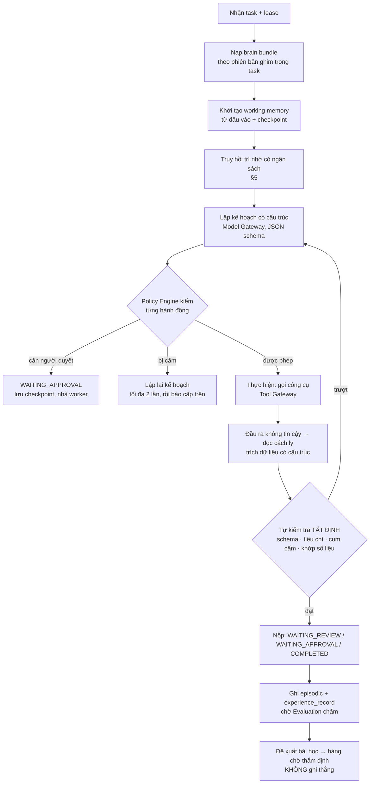

# BRAIN_SPEC: Agent Brain Blueprint

> Trạng thái: v0.2 (26/11/2026, theo `DECISIONS.md`), chờ Owner duyệt. Đây là module ưu tiên số 1 của SRS ("Individual Brain Engine").
> Mục tiêu của tài liệu: các agent phải khác nhau về **trạng thái, dữ liệu, quyền và lịch sử**, chứ không chỉ khác nhau ở system prompt (SRS §1.3).

## 1. Bộ não gồm những gì

Một agent = **brain bundle** (cấu hình có phiên bản, bất biến) + **trạng thái sống** (trí nhớ, kinh nghiệm, KPI, lịch sử) + **runtime chung**.

| Thành phần | Nằm ở đâu | Ai được sửa | Làm agent khác nhau thế nào |
|---|---|---|---|
| Identity: profile, role, personality | `brains/<id>/identity/*.yaml` | Owner (qua đề xuất có phiên bản) | Vai trò, phạm vi trách nhiệm, *tham số phong cách* (giọng, mức chấp nhận rủi ro, độ chi tiết) |
| Constitution: quy tắc cốt lõi | `brains/_core/constitution.yaml` + `brains/<id>/identity/role.yaml#hard_rules` | **Chỉ Owner**, khóa bằng hash | Giới hạn tuyệt đối (vd Ads Agent không tăng ngân sách vượt hạn mức) |
| Reasoning, Planning, Decision policy | `reasoning/*.yaml` | Owner; agent chỉ được *đề xuất* | Cách lập kế hoạch, ngưỡng tự quyết hay xin ý kiến, số bước tối đa, khi nào hỏi Director |
| Skills (quy trình) | `skills/` + procedural memory | Learning Engine đề xuất, thẩm định rồi mới thêm | Mỗi agent có thư viện quy trình riêng, được cải thiện theo kinh nghiệm |
| Tool permissions | `tools/tool_permissions.yaml` | **Chỉ Owner** | Công cụ nào, cấp tự chủ nào, hạn mức nào |
| Knowledge | `knowledge/*` (tham chiếu tài liệu) + semantic memory | Learning Engine qua quy trình duyệt | Kiến thức chuyên môn riêng (SEO khác Ads) |
| Memory: working, episodic, semantic, procedural | CSDL (bảng memory, RLS theo chủ sở hữu) | Runtime ghi episodic; phần còn lại qua thẩm định | Lịch sử và kinh nghiệm riêng, agent khác không đọc được nếu không có quyền |
| Experience | `experience_records` + bài học | Evaluation và Learning Engine | Biết việc nào từng thành công hay thất bại, vì sao |
| Evaluation rules + KPI | `evaluation/*.yaml` | Owner | Mỗi vai trò được đo bằng tiêu chí riêng |
| Model config | `brain.yaml#model` → hồ sơ trong Model Gateway | Owner | Model chính, model dự phòng, nhiệt độ, giới hạn token |

## 2. Cấu trúc bundle (theo SRS §4.1)

```
brains/
├── _core/
│   ├── constitution.yaml          # quy tắc áp cho MỌI agent; hash được ghim trong CSDL
│   └── templates/                 # mẫu theo phòng ban để kế thừa
│       ├── director.yaml
│       └── specialist_marketing.yaml
└── seo_agent/
    ├── brain.yaml                 # manifest: phiên bản, kế thừa, model, ngân sách
    ├── identity/{profile,role,personality}.yaml
    ├── reasoning/{reasoning_policy,planning_policy,decision_policy}.yaml
    ├── knowledge/{domain_knowledge,research,reference_documents}/   # chỉ tham chiếu; nội dung nằm trong CSDL
    ├── skills/skill_registry.yaml
    ├── tools/tool_permissions.yaml
    └── evaluation/{performance,evaluation_rules}.yaml
```

Các thư mục `memory/` và `experience/` trong SRS §4.1 là **trạng thái sống**, nên được lưu trong CSDL thay vì trong tệp. Cách này cho phép phân quyền, tìm kiếm, sao lưu và giao dịch. Cấu trúc logic vẫn giữ đúng 4 loại trí nhớ và 4 nhóm kinh nghiệm của SRS. Dashboard hiển thị theo đúng cây thư mục SRS.

### 2.1. Ví dụ `seo_agent/brain.yaml`

```yaml
agent_id: seo_agent
extends: _core/templates/specialist_marketing.yaml
versions:            # SRS §4.5
  brain_version: 1.0.0
  prompt_version: 1.0.0
  knowledge_version: 1.0.0
  skill_version: 1.0.0
department: marketing
reports_to: marketing_director
model:
  primary: reasoning_mid        # hồ sơ trong Model Gateway, KHÔNG phải tên nhà cung cấp
  fallback: local_general
  parameters: { temperature: 0.3, max_output_tokens: 6000 }
  capabilities: { reasoning: true, tool_calling: true, structured_output: true }
budget:
  usd_per_day: 0.50             # trần riêng của agent, nằm trong trần chung của công ty
  max_steps_per_task: 12
  max_tool_calls_per_task: 20
memory:
  retrieval_budget_tokens: 6000
  share_ratio: { procedural: 0.2, experience: 0.25, semantic: 0.35, shared: 0.2 }
schedule_ref: schedules/seo_agent   # lịch nằm trong CSDL, cấu hình được
```

### 2.2. `personality.yaml`: tham số, không chỉ là văn

```yaml
voice: { tone: "chuyên nghiệp, gần gũi", formality: 0.6, emoji: false }
risk_tolerance: 0.3        # dùng trong decision_policy: dưới ngưỡng tự tin → hỏi Director
verbosity: 0.4             # giới hạn độ dài báo cáo
evidence_strictness: 0.8   # tỉ lệ khẳng định bắt buộc có nguồn
```

Các tham số này **đi vào mã**, không chỉ vào prompt. Ví dụ `evidence_strictness` quyết định bước tự kiểm tra có chặn kết quả thiếu nguồn hay không. `risk_tolerance` quyết định ngưỡng chuyển lên cấp trên.

### 2.3. `decision_policy.yaml`

```yaml
escalate_when:
  - confidence_below: 0.6                  # mức tự tin của kế hoạch (LLM tự báo, đã hiệu chỉnh bằng lịch sử)
  - action_in: [publish, spend, contact_customer]
  - conflicts_with_memory: true            # kết quả mới mâu thuẫn với bài học đã kiểm chứng
ask_clarification_when:
  - missing_inputs: [target_keyword_or_topic]
prefer_reuse:
  min_similarity: 0.82                     # có quy trình/kinh nghiệm đủ giống → dùng lại trước khi nghĩ mới
```

## 3. Bốn loại trí nhớ

| Loại | Lưu gì | Ghi bởi | Vòng đời | Truy hồi khi |
|---|---|---|---|---|
| **Working** | Mục tiêu task, các bước đã làm, giả thuyết, việc chờ | Runtime | Redis khi đang chạy, checkpoint vào `tasks.state` sau mỗi bước, xóa khi task đóng (giữ bản tóm tắt) | Luôn có (của task hiện tại) |
| **Episodic** | "Đã làm gì, lúc nào, kết quả ra sao": task, đầu vào, đầu ra, đánh giá, chi phí | Runtime (tự động) | Giữ 12 tháng. Sau 90 ngày thì gom và tóm tắt (consolidation) | Task tương tự (theo loại việc + nội dung) |
| **Semantic** | Kiến thức đã kiểm chứng: SEO, sản phẩm, thị trường. Mỗi mục có nguồn, độ tin cậy, trạng thái xác minh | Learning Engine (sau thẩm định) | `candidate → verified → active → deprecated → retired`; có hạn hiệu lực (`valid_to`) | Câu hỏi về sự thật hoặc quy tắc |
| **Procedural** | Quy trình làm việc (từng bước, checklist, mẫu), có phiên bản | Learning Engine; Owner duyệt nếu ảnh hưởng nội dung công khai | Có phiên bản; bản cũ giữ để rollback | Khi bắt đầu một loại việc |

Hai nhóm "kinh nghiệm" của SRS (`successful_tasks`, `failed_tasks`) là **các góc nhìn** trên episodic + `experience_records` lọc theo kết quả. Hai nhóm còn lại: `lessons_learned` là semantic memory sinh ra từ kinh nghiệm, `reusable_patterns` là procedural memory sinh ra từ kinh nghiệm.

### 3.1. Mô hình bản ghi trí nhớ chung

```text
memory {
  id, owner_scope: "agent:seo_agent" | "dept:marketing" | "company" | "owner_only",
  type: working|episodic|semantic|procedural,
  title, content, search_text (đã bỏ dấu), metadata jsonb (topic, product_id, task_type, channel…),
  source_ref (url|file|task_id|message_id), source_trust: owner|internal|verified_external|unverified_external,
  confidence 0..1, verification_status, valid_from, valid_to,
  created_by_principal, version, supersedes_id, content_hash
}
```

## 4. Vòng nhận thức một bước (Agent Runtime)



**Hiện thực (v0.2, ADR-05):** vòng trên là một **đồ thị LangGraph**. Mỗi ô là một nút; checkpoint được lưu sau mỗi nút vào Postgres. Ô `WAITING_APPROVAL` dùng `interrupt()`; Owner bấm nút trên Telegram hoặc dashboard thì đồ thị chạy tiếp. Đồ thị được dựng từ brain bundle, nên mọi agent dùng chung một mã đồ thị nhưng khác policy, công cụ và trí nhớ.

Các quy tắc của runtime:
- **Checkpoint sau mỗi bước.** Worker chết thì lease hết hạn, worker khác tiếp tục từ checkpoint. Lời gọi công cụ có tác động mang khóa chống trùng (`task_id:step_no`), nên chạy lại không bị làm hai lần.
- **Giới hạn cứng** trên mỗi task: số bước, số lời gọi công cụ, token, USD, thời gian. Vượt giới hạn thì `FAILED` kèm lý do và báo cấp trên.
- **Phiên bản bộ não được ghim** lúc tạo task. Đổi bộ não giữa chừng không ảnh hưởng task đang chạy. Kết quả nào cũng truy được về đúng phiên bản bộ não đã sinh ra nó.
- **"Tự kiểm tra" không phải "tự chấm".** Đây là kiểm tra tất định (đúng hay sai), không phải điểm chất lượng. Điểm chất lượng chỉ do Evaluation Service cho (§8).

## 5. Truy hồi trí nhớ (SRS §4.4)

1. **Lập truy vấn**: tạo từ task (tiêu đề, mục tiêu, loại việc, thực thể như sản phẩm/kênh/từ khóa). Không gửi cả lịch sử hội thoại.
2. **Lọc trước, xếp hạng sau.** RLS + `owner_scope` mà agent được đọc, `type`, `verification_status ∈ {verified, active}` cho semantic, `valid_to > now`, metadata (sản phẩm, kênh).
3. **Hai danh sách ứng viên**: theo từ khóa (`search_text` bỏ dấu, trigram/`tsvector simple`, dùng lại bộ chuẩn hóa `textnorm` của repo) và theo vector (cosine, HNSW). Mỗi danh sách lấy khoảng 50 mục.
4. **Ghép**: `score = RRF(k=60) × w_recency(type) × (0,5 + 0,5·confidence) × w_trust(source_trust)`.
   - Thời gian bán rã: episodic 60 ngày, semantic theo `valid_to`, procedural không giảm.
5. **Đóng gói theo ngân sách token** và tỉ lệ `share_ratio` của brain; loại các mục gần trùng nhau (MMR).
6. **Trích dẫn**: mỗi mục đưa vào ngữ cảnh có `memory_id`. Kết quả của agent phải nêu `memory_id` mình đã dựa vào. Owner bấm "Giải thích căn cứ" (SRS §12.4) để thấy đúng các mục này.
7. **Ghi lại lượt truy hồi** (`memory_access_log`): phục vụ audit, và cho biết mục nào thực sự hữu ích (mục được dùng trong kết quả đạt thì tăng `usefulness`).

## 6. Trí nhớ riêng, trí nhớ chung, phân quyền (SRS §4.3)

| Phạm vi | Đọc | Ghi | Ví dụ |
|---|---|---|---|
| `agent:<id>` | Chính agent; Director quản lý trực tiếp (chỉ đọc); Owner | Chính agent (chỉ episodic/working); Learning Engine (semantic/procedural sau thẩm định) | Kinh nghiệm viết bài của SEO Agent |
| `dept:<id>` | Agent trong phòng; Director; CEO; Owner | Director (sau thẩm định) | Quy trình chung của phòng Marketing |
| `company` (Shared) | Mọi agent | **Chỉ qua Knowledge Approval** | Thông tin sản phẩm đã xác thực, brand guidelines, chiến lược đã duyệt, mục tiêu chung |
| `owner_only` | Owner | Owner | Giá vốn, lợi nhuận, ghi chú nhạy cảm |

- Thực thi ở **hai lớp**: lớp Memory Service kiểm tra quyền, và **Row-Level Security** của Postgres (phiên CSDL đặt `app.principal`). Lỗi ở lớp ứng dụng vẫn không làm lộ dữ liệu.
- **Chia sẻ**: agent A muốn chia sẻ một mục cho B thì gửi message `knowledge_sharing`. Mục đó vào hộp *ứng viên* của B (hoặc của phòng) và phải qua thẩm định. A không ghi được vào vùng nhớ của B.
- Thông tin sản phẩm trong `company` được **đồng bộ từ website** (nhãn, thành phần, dị ứng). Nguồn này đáng tin nhất. Kiến thức khác mâu thuẫn với nó thì bị gắn cờ.

## 7. Learning Engine (SRS §5)

### 7.1. Bảy module

| Module | Vào | Ra | Ghi chú |
|---|---|---|---|
| Research Collector | Lịch học, yêu cầu từ task, tài liệu Owner tải lên | `research_sources` (URL/tệp, thời điểm, hash, tình trạng truy cập) | Tuân thủ robots/ToS; nội dung lưu nguyên bản ở object storage |
| Knowledge Extractor | Nguồn đã thu | `knowledge_candidates` (mệnh đề ngắn + trích dẫn vị trí trong nguồn) | Chạy ở **tầng đọc cách ly**: model không có công cụ, đầu ra là JSON có schema |
| Knowledge Validator | Ứng viên | Điểm: độ tin nguồn, trùng lặp, liên quan, chính xác (đối chiếu nhiều nguồn/dữ liệu nội bộ), mâu thuẫn | 5 cửa theo SRS §5.5 |
| Memory Manager | Ứng viên đã duyệt | Ghi semantic/procedural có phiên bản; gom và tóm tắt episodic; đánh dấu hết hạn | Chạy đêm |
| Experience Evaluator | `experience_records` + điểm đánh giá | Bài học đề xuất kèm bằng chứng | Áp thang bằng chứng §7.3 |
| Learning Scheduler | Mục tiêu học của từng agent, ngân sách | `learning_sessions` | Học có chủ đích: lỗ hổng kiến thức lấy từ task thất bại |
| Knowledge Version Manager | Mọi thay đổi semantic/procedural | `knowledge_version` của agent tăng; changelog đủ trường SRS §4.5 | Rollback theo phiên bản |

### 7.2. Đường duyệt kiến thức mới (SRS §5.5)

```
ứng viên → [Nguồn] tin cậy? còn truy cập? → [Trùng] hash/ngữ nghĩa ≥ 0,92 → gộp → [Liên quan] đúng phạm vi agent?
        → [Chính xác] ≥ 2 nguồn độc lập HOẶC nguồn chính thức HOẶC Owner xác nhận; không mâu thuẫn dữ liệu sản phẩm
        → [Duyệt] tự động nếu rủi ro thấp & điểm ≥ ngưỡng; còn lại → Owner/Director
        → cập nhật knowledge base (phiên bản mới, giữ bản cũ)
```

Những thứ **không bao giờ** được tự động duyệt:
- thay đổi quy tắc cốt lõi, quyền, chính sách bảo mật, cấu hình hệ thống (SRS §5.5);
- khẳng định về công dụng sức khỏe của sản phẩm.

### 7.3. Học từ kết quả: thang bằng chứng (SRS §5.4)

| Mức | Điều kiện | Được dùng thế nào |
|---|---|---|
| L0 Quan sát | 1 trải nghiệm | Chỉ nằm trong episodic |
| L1 Gợi ý | ≥ 3 trải nghiệm cùng loại cùng chiều; đánh giá độc lập | Đưa vào ngữ cảnh với nhãn "gợi ý, chưa kiểm chứng" |
| L2 Tương quan | ≥ 10 mẫu; khác biệt vượt nhiễu (khoảng tin cậy bootstrap không chứa 0, hoặc hậu nghiệm Beta P(tốt hơn) ≥ 0,9) | Thành bài học, ghi rõ "**tương quan**", có hạn xem lại |
| L3 Đã kiểm chứng | Có thí nghiệm đối chứng (A/B hoặc holdout do Growth Director thiết kế), chỉ số chính đăng ký trước | Thành quy trình (procedural); Owner duyệt nếu ảnh hưởng nội dung công khai |

- **Tương quan không phải nhân quả**: bài học L2 không được viết dưới dạng nhân quả ("vì X nên Y"). Đây là quy tắc kiểm tra tất định trên văn bản của bài học.
- **Gây nhiễu thường gặp** cần ghi lại khi phân tích: mùa vụ/Tết, Flash Sale, ngân sách quảng cáo thay đổi, sản phẩm hết hàng.
- Ví dụ SRS (100 video): mỗi video là một `content_asset` có thuộc tính (độ dài, hook, chủ đề, giờ đăng). Số liệu kênh được gom vào. Data Analyst chạy phân tích theo thuộc tính. Content Agent nhận *bài học L2* (vd "video ≤ 30 giây có hook câu hỏi có tỉ lệ xem hết cao hơn, tương quan, 46 mẫu"). Growth Director có thể đề xuất A/B để nâng lên L3.

### 7.4. Học từ phản hồi của con người

Đây là kênh đã chứng minh hiệu quả ở bộ não hiện tại. Kết quả duyệt được quy đổi như sau:

| Kết quả | Quy đổi |
|---|---|
| Duyệt nguyên văn | 1 đạt |
| Sửa rồi duyệt | 0,6 đạt / 0,4 không đạt |
| Từ chối, gỡ | 1 không đạt |

- Độ tin cậy là Beta trên 90 ngày, theo **(agent, loại việc)**.
- Góp ý của người duyệt thành *ghi chú hướng dẫn* trong ngữ cảnh của lần sau.
- **Phản hồi qua Telegram (v0.2):**

  | Owner làm gì | Hệ thống hiểu là |
  |---|---|
  | Bấm **Gỡ bài** | `retracted` (không đạt) |
  | Bấm **Góp ý** | Ghi chú hướng dẫn, như từ chối kèm góp ý |
  | Bấm **Duyệt** cho bài chờ duyệt | `approved` |
  | Không làm gì với bài đã tự xuất bản | **Không** tính là đồng ý. Chất lượng bài sẽ được đo bằng số liệu thật (GSC, thời gian đọc) sau 28 ngày |
- **Mới so với bản hiện tại:** khi nhân viên *sửa* bản nháp, hệ thống lưu bản diff. Learning Engine gom các mẫu sửa lặp lại (vd luôn bỏ câu mở đầu quảng cáo) thành ứng viên quy tắc phong cách, rồi đưa qua thẩm định.

## 8. Đánh giá độc lập

Nguyên tắc: **người làm không tự chấm việc mình làm**. Evaluation Service là một principal riêng, có rubric theo loại việc trong `evaluation_rules.yaml`.

| Tầng tín hiệu | Ví dụ | Trọng số mặc định |
|---|---|---|
| 1. Kiểm tra tất định | Đúng schema, độ dài title/meta, không có cụm cấm (cam kết chữa bệnh…), giá/số liệu khớp DB, link nội bộ tồn tại, đủ nguồn | Cổng chặn (trượt = 0) |
| 2. Phản hồi con người | Duyệt/sửa/từ chối, chấm sao trên dashboard | Cao nhất |
| 3. Kết quả kinh doanh | Click và vị trí GSC của trang, CTR quảng cáo, đơn hàng có gắn nguồn | Cao, nhưng phải có cửa sổ quan sát và mẫu tối thiểu |
| 4. LLM-judge | Rubric chấm bởi model **khác họ** với model đã viết (v0.2: bài do Claude viết thì OpenAI chấm, và ngược lại) | Thấp, chỉ dùng khi đã đo độ khớp với người (≥ 50 mẫu, κ ≥ 0,6); tự giảm trọng số nếu lệch |

KPI của agent được tính từ các tầng trên, không từ báo cáo tự khai của agent. Dashboard hiển thị cả số mẫu và khoảng tin cậy, để không ai kết luận từ 3 mẫu.

## 9. Phiên bản bộ não (SRS §4.5)

- Mỗi thành phần có semver riêng (`brain`, `prompt`, `knowledge`, `skill`). Mỗi lần đổi ghi `agent_versions` gồm:
  - diff;
  - nguồn tham khảo;
  - thời điểm;
  - người hoặc agent đề xuất;
  - kết quả kiểm tra (test và eval);
  - phiên bản trước.
- **Quy tắc cốt lõi** (`constitution.yaml`, `hard_rules`, `tool_permissions`) được băm SHA-256 và ghim trong CSDL. Runtime từ chối nạp bundle có hash lệch mà không có bản ghi duyệt của Owner.
- **Thăng hạng an toàn**:
  1. Bản mới chạy *shadow* trên N task thật: kết quả chỉ đem chấm, không giao.
  2. So sánh điểm đánh giá.
  3. Owner bấm "thăng hạng".
  4. Rollback là một thao tác (trỏ lại phiên bản cũ).

## 10. Kế thừa từ bộ não "Trưởng văn phòng" hiện có

| Đã có trong `ai/xuong_ai/brain/` | Trở thành trong nền tảng mới |
|---|---|
| `senses.py` (tín hiệu từ dữ liệu) | Bộ tín hiệu của Data Analyst + CEO; công cụ `signals.read` |
| `planner.py` (điểm = mục tiêu × mức độ × tin cậy; nội quy) | Hàm ưu tiên của Orchestrator + Policy Engine |
| `learning.py` (Beta, góp ý, số lần thử, chuyển người) | Kênh học từ phản hồi con người (§7.4) |
| `max_pending_review` (sức duyệt) | Ngân sách duyệt của Owner, theo phòng ban |
| `human_only_question_types` | Cửa tuân thủ: chủ đề sức khỏe/dị ứng luôn qua người |
| Bản tin mỗi sáng | Báo cáo 18:00 của AI CEO (SRS §14) |

## 11. Chứng minh yêu cầu đặc biệt (SRS §19)

Kịch bản nghiệm thu `AC-BRAIN-01`, chạy cho **từng** agent trong 15 agent (TEST_PLAN §5):

1. **Phiên 1.** Giao task loại X. Người duyệt từ chối kèm góp ý cụ thể (vd "meta description phải có tên sản phẩm"). Kiểm tra: có episodic + experience_record + ghi chú hướng dẫn.
2. **Khởi động lại toàn hệ thống** (phiên mới, working memory trống).
3. **Phiên 2.** Giao task loại X tương tự. Kiểm tra:
   - (a) truy hồi trả về đúng `memory_id` của kinh nghiệm phiên 1;
   - (b) ngữ cảnh gửi model có ghi chú đó;
   - (c) đầu ra qua kiểm tra tất định của góp ý.
4. Evaluation chấm đầu ra phiên 2 cao hơn phiên 1 trên rubric tương ứng. Điểm này do evaluator độc lập chấm, không do agent tự chấm.
5. Agent khác **không** truy hồi được kinh nghiệm này (trí nhớ riêng), trừ khi đã chia sẻ qua thẩm định.
