# DATABASE_SCHEMA: lược đồ PostgreSQL + pgvector

> Trạng thái: v0.2 (26/11/2026, theo `DECISIONS.md`), chờ Owner duyệt. Có đủ mọi bảng SRS §11 yêu cầu. Bảng **bổ sung** (không có trong SRS) được đánh dấu ➕ kèm lý do.

## 1. Quy ước chung

- **Khóa chính** `id uuid`, sinh theo **UUIDv7** để sắp được theo thời gian và giữ chỉ mục gọn. Postgres < 18 sinh ở tầng ứng dụng.
- **Cột chung** (SRS): `created_at timestamptz`, `updated_at timestamptz`, `status`, `version int`. Bảng có dữ liệu của tổ chức có thêm `org_id uuid`: hiện chỉ một xưởng, nhưng sẵn sàng tách dữ liệu sau này (SRS "tenant scope khi cần").
- **Khóa lạc quan:** `UPDATE … WHERE version = :v`, tránh hai worker ghi đè nhau.
- **Thời gian** lưu UTC, hiển thị Asia/Ho_Chi_Minh (giống website).
- **Tiền** dùng `bigint` VND, hoặc `numeric(12,6)` USD cho chi phí LLM.
- **JSON** dùng `jsonb`, kèm `CHECK (jsonb_typeof(...) = 'object')` ở các cột cấu trúc.
- **Migration** dùng Alembic. Mỗi migration có cả up và down, chạy trong CI trên Postgres thật (testcontainers).
- **Vai trò CSDL:**
  - `app_api`: đọc/ghi qua dịch vụ;
  - `app_worker`;
  - `app_readonly_analytics`: chỉ đọc các view đã ẩn danh;
  - `app_audit_writer`: chỉ INSERT vào audit.

  **Không có vai trò nào cho agent**: agent không bao giờ cầm kết nối CSDL (SRS §15).

## 2. Sơ đồ quan hệ chính

```mermaid
erDiagram
  agents ||--|| agent_profiles : ""
  agents ||--o{ agent_brains : "phiên bản đang chạy/lịch sử"
  agent_brains ||--o{ agent_versions : "changelog"
  agents ||--o{ agent_permissions : ""
  agents ||--o{ agent_skills : ""
  agents ||--|| agent_status : ""
  agents ||--o{ agent_memories : "owner_scope"
  agent_memories ||--o{ memory_embeddings : ""
  agent_memories ||--o| episodic_memories : "chi tiết"
  agent_memories ||--o| semantic_memories : "chi tiết"
  agent_memories ||--o| procedural_memories : "chi tiết"
  tasks ||--o{ task_assignments : ""
  tasks ||--o{ task_dependencies : ""
  tasks ||--o{ task_outputs : ""
  tasks ||--o{ task_reviews : ""
  tasks ||--o{ task_logs : ""
  tasks ||--o{ experience_records : ""
  experience_records ||--o{ evaluation_results : ""
  research_sources ||--o{ knowledge_candidates : ""
  knowledge_candidates ||--o{ knowledge_approvals : ""
  agent_conversations ||--o{ agent_messages : ""
  model_registry ||--o{ model_usage : ""
  tool_registry ||--o{ tool_invocations : ""
```



## 3. Quản lý agent

| Bảng | Cột chính | Ràng buộc / chỉ mục |
|---|---|---|
| `agents` | `id`, `agent_key` (vd `seo_agent`), `department`, `reports_to_agent_id`, `kind` (`executive/director/specialist`), `status` | `UNIQUE(org_id, agent_key)` |
| `agent_profiles` | `agent_id`, `display_name`, `avatar_url`, `role_summary`, `personality jsonb` (tham số BRAIN_SPEC §2.2) | 1–1 với `agents` |
| `agent_brains` | `id`, `agent_id`, `brain_version`, `prompt_version`, `knowledge_version`, `skill_version`, `bundle jsonb` (đã chuẩn hóa), `bundle_hash`, `core_rules_hash`, `state` (`draft/shadow/active/retired`), `activated_at` | Tối đa 1 bản `active` cho mỗi agent (unique index một phần) |
| `agent_versions` | `id`, `agent_id`, `component`, `from_version`, `to_version`, `diff`, `sources jsonb`, `proposed_by_principal`, `test_results jsonb`, `approved_by_user_id`, `previous_brain_id` | Chỉ thêm, không sửa (SRS §4.5) |
| `agent_permissions` | `agent_id`, `tool_id`, `action`, `autonomy_level 1..4`, `limits jsonb` (vd `max_usd`, `per_day`), `requires_approval bool`, `granted_by_user_id`, `expires_at` | `UNIQUE(agent_id, tool_id, action)`. Chỉ người dùng ghi |
| `agent_skills` | `agent_id`, `skill_key`, `version`, `procedural_memory_id`, `enabled` | |
| `agent_status` | `agent_id`, `state`, `reason`, `circuit_failures`, `paused_by`, `updated_at` | |
| ➕ `agent_budgets` | `agent_id`, `period` (`day/month`), `usd_limit`, `usd_used`, `token_used` | Ngân sách theo agent (ARCH §8) |

## 4. Trí nhớ

| Bảng | Cột chính | Ghi chú |
|---|---|---|
| `agent_memories` | `id`, `owner_scope` (`agent:<key>` / `dept:<key>` / `company` / `owner_only`), `type`, `title`, `content`, `search_text` (bỏ dấu), `tsv tsvector` (tạo từ `search_text`, cấu hình `simple`), `metadata jsonb`, `source_ref`, `source_trust`, `confidence numeric(3,2)`, `verification_status`, `valid_from`, `valid_to`, `usefulness`, `content_hash`, `supersedes_id`, `created_by_principal` | Bảng gốc cho mọi loại trí nhớ. Chỉ mục GIN trên `tsv`, trigram trên `search_text`, B-tree `(owner_scope, type, verification_status)`, GIN trên `metadata` |
| `memory_embeddings` | `memory_id`, `embedding_model_id`, `dims`, `embedding vector` | Chỉ mục HNSW `vector_cosine_ops` **cho từng model**. Mỗi model một bảng con, vì số chiều vector khác nhau |
| `episodic_memories` | `memory_id`, `task_id`, `task_type`, `outcome` (`success/failure/partial`), `cost_usd`, `occurred_at` | |
| `semantic_memories` | `memory_id`, `claim`, `evidence jsonb` (danh sách nguồn + vị trí), `evidence_level` (`L1..L3`), `topic` | |
| `procedural_memories` | `memory_id`, `procedure_key`, `version`, `steps jsonb`, `checklist jsonb`, `applies_to_task_types text[]` | `UNIQUE(procedure_key, version)` |
| `shared_knowledge` | `memory_id`, `category` (`product/brand/goal/strategy/policy`), `approved_by`, `effective_from` | View trên `agent_memories` với `owner_scope='company'` cộng metadata duyệt |
| `experience_records` | `id`, `agent_id`, `task_id`, `brain_id`, `task_type`, `inputs_digest`, `output_ref`, `human_verdict`, `business_metrics jsonb`, `observed_window`, `score`, `score_breakdown jsonb` | Nguồn của bài học. Điểm do Evaluation Service ghi |
| ➕ `memory_access_log` | `memory_id`, `principal`, `task_id`, `purpose`, `used_in_output bool`, `at` | Audit truy hồi + tính `usefulness` (BRAIN_SPEC §5.7). Phân vùng theo tháng |

### 4.1. Row-Level Security (ví dụ)

```sql
ALTER TABLE agent_memories ENABLE ROW LEVEL SECURITY;
-- Phiên làm việc của Memory Service đặt: SET LOCAL app.principal = 'agent:seo_agent'; SET LOCAL app.scopes = '{agent:seo_agent,dept:marketing,company}';
CREATE POLICY mem_read ON agent_memories FOR SELECT
  USING (owner_scope = ANY (string_to_array(current_setting('app.scopes', true), ',')));
CREATE POLICY mem_write_episodic ON agent_memories FOR INSERT
  WITH CHECK (type IN ('episodic','working') AND owner_scope = current_setting('app.principal', true));
-- semantic/procedural/company chỉ ghi được bằng vai trò learning_engine (policy riêng).
```

## 5. Học tập

| Bảng | Cột chính |
|---|---|
| `learning_sessions` | `id`, `agent_id`, `goal`, `trigger` (`schedule/failure/owner`), `budget_usd`, `status`, `summary` |
| `research_sources` | `id`, `url_or_file`, `fetched_at`, `content_hash`, `object_key` (bản gốc), `robots_ok`, `tos_note`, `trust` |
| `knowledge_candidates` | `id`, `source_id`, `proposed_by_principal`, `target_scope`, `claim`, `evidence jsonb`, `dup_of_memory_id`, `scores jsonb` (nguồn, trùng, liên quan, chính xác), `risk` (`low/medium/high`), `status` |
| `knowledge_approvals` | `candidate_id`, `decision`, `decided_by` (user hoặc `auto:validator@v`), `reason`, `resulting_memory_id` |
| `evaluation_results` | `id`, `experience_id`, `evaluator` (`deterministic/human/business/llm_judge`), `rubric_key`, `rubric_version`, `score`, `details jsonb`, `evaluator_model_id` |
| `improvement_proposals` | `id`, `agent_id`, `component`, `proposal`, `evidence jsonb`, `shadow_results jsonb`, `status`, `decided_by` |

## 6. Nhiệm vụ

| Bảng | Cột chính | Ghi chú |
|---|---|---|
| `tasks` | `id`, `parent_id`, `root_id`, `depth`, `title`, `description`, `task_type`, `created_by_principal`, `assigned_agent_id`, `priority`, `deadline`, `input_data jsonb`, `output_data jsonb`, `success_criteria jsonb`, `status` (9 trạng thái SRS), `requires_approval`, `autonomy_max`, `budget_usd`, `spent_usd`, `brain_id` (ghim), `state jsonb` (checkpoint của working memory), `attempt`, `max_attempts`, `lease_owner`, `lease_until`, `idempotency_key`, `timeout_at` | `UNIQUE(idempotency_key)`; chỉ mục `(status, lease_until)` để quét việc bị bỏ dở |
| `task_assignments` | `task_id`, `agent_id`, `assigned_by`, `assigned_at`, `unassigned_at` | Lịch sử giao lại |
| `task_dependencies` | `task_id`, `depends_on_task_id` | Kiểm tra không có chu trình khi thêm |
| `task_messages` | `task_id`, `message_id` | Liên kết task ↔ message |
| `task_outputs` | `task_id`, `kind`, `content jsonb`, `asset_id`, `version` | |
| `task_reviews` | `task_id`, `reviewer_principal`, `verdict` (`approve/request_changes/reject`), `notes`, `rubric_scores jsonb` | |
| `task_logs` | `task_id`, `step_no`, `event`, `data jsonb`, `at` | Phân vùng theo tháng |
| ➕ `approvals` | `id`, `subject_type`, `subject_id`, `action`, `requested_by`, `risk`, `payload_digest`, `status`, `decided_by_user_id`, `decided_at`, `expires_at` | Hàng chờ phê duyệt chung cho task, công cụ, kiến thức, quyền (SRS §13) |
| ➕ `schedules` | `id`, `agent_id`, `cron`, `timezone`, `task_template jsonb`, `enabled`, `last_run_at`, `next_run_at` | Lịch cấu hình được (SRS §14) |

**Checkpoint LangGraph (v0.2, ADR-05):** bảng do thư viện quản lý (checkpoint, các lần ghi đang chờ) nằm trong schema riêng `langgraph` của cùng CSDL. `thread_id` = `tasks.id`. Bảng `tasks` thêm cột `graph_key` (đồ thị nào đang chạy) và `graph_node` (nút gần nhất, để hiển thị). Checkpoint của task đã đóng được dọn sau 30 ngày.

Các chuyển trạng thái hợp lệ được kiểm tra trong mã **và** bằng trigger:

```
CREATED→PENDING→ASSIGNED→IN_PROGRESS→{WAITING_REVIEW|WAITING_APPROVAL|COMPLETED|FAILED}
WAITING_REVIEW→{IN_PROGRESS (làm lại)|WAITING_APPROVAL|COMPLETED}
WAITING_APPROVAL→{IN_PROGRESS|COMPLETED|CANCELLED}
*→CANCELLED (trừ COMPLETED)
FAILED→PENDING (retry nếu còn lượt)
```

## 7. Giao tiếp

| Bảng | Cột chính |
|---|---|
| `agent_messages` | Đúng schema SRS §6.1 (`message_id`, `sender_agent`, `receiver_agent`, `message_type`, `task_id`, `priority`, `payload`, `created_at`, `status`) cộng `conversation_id`, `correlation_id`, `idempotency_key`, `trust`, `expires_at`, `delivered_at`, `attempts` |
| `agent_conversations` | `id`, `kind` (`owner_chat/agent_chat/company_chat`), `participants`, `title` |
| `collaboration_sessions` | `id`, `root_task_id`, `topic`, `options jsonb`, `evidence jsonb`, `decision`, `decided_by` |

`agent_messages` đồng thời là **outbox**: ghi trong cùng giao dịch với thay đổi task, rồi dispatcher phát đi (P4).

## 8. Nghiệp vụ

Nguyên tắc: dữ liệu bán hàng là **bản sao chỉ đọc** từ website (ADR-14). Nền tảng không tự tạo đơn hay sửa giá.

| Bảng | Nguồn | Ghi chú quyền |
|---|---|---|
| `products` | `catalog` của website | Theo mẫu SRS §10 (`product_id`, `name`, `category`, `selling_price`, `stock_quantity`, `description`, `ingredients`, `images`, `compliance_documents`, `status`) cộng `info_version` |
| ➕ `product_costs` | Nhập tay hoặc `finance:read` | Tách riêng để **phân quyền giá vốn** (SRS §10). Chỉ `owner_only` và Data Analyst (`finance.read`) đọc được |
| `customers` | `customer_key` (mã băm) + phân khúc + đồng ý tiếp thị | **Không có tên/SĐT/địa chỉ** theo mặc định (P6, Owner đồng ý ở Q-L1) |
| `orders` | `events`/`snapshot` | Dạng tối thiểu như dịch vụ hiện tại |
| `campaigns` | Ads Agent (nháp) + API quảng cáo | `status`: `draft/proposed/approved/live/ended`; chỉ người chuyển sang `live` |
| `leads` | Sales Intelligence | Mỗi dòng có `source_url`, `collected_at`, `contact_allowed bool`; tự xóa nếu không dùng sau 180 ngày |
| `affiliates` | Affiliate Agent | Tương tự `leads` + `commission_policy`, mã giới thiệu |
| `content_assets` | Content/Creative | `object_key`, `kind`, `ai_generated bool`, `brand_check jsonb`, `published_url`, `metrics jsonb` |
| `marketing_reports` | Data Analyst, CEO | `period`, `body`, `data_refs` |
| ➕ `metric_snapshots` | GA4, GSC, Ads, website | `source`, `entity_type`, `entity_id`, `date`, `metrics jsonb`: chuỗi thời gian để đánh giá kết quả |

## 9. Hạ tầng

| Bảng | Cột chính |
|---|---|
| `model_registry` | `id`, `profile` (`reasoning_high`…), `provider_id`, `model_name`, `context_window`, `price_in_per_mtok`, `price_out_per_mtok`, `capabilities jsonb`, `fallback_model_id`, `enabled` |
| ➕ `provider_registry` | `id`, `kind` (`anthropic/openai_compat/google/ollama/vllm`), `base_url`, `secret_ref`, `rate_limits jsonb`, `data_policy` (`may_receive_pii false` mặc định) |
| `model_usage` | `id`, `model_id`, `agent_id`, `task_id`, `purpose`, `tokens_in`, `tokens_out`, `cost_usd`, `latency_ms`, `ok`, `error_code`, `at` (phân vùng theo tháng) |
| `tool_registry` | `id`, `tool_key`, `description`, `input_schema`, `output_schema`, `side_effects` (`none/internal/external`), `default_timeout_s`, `retry_policy jsonb`, `risk`, `mcp_server` |
| ➕ `tool_invocations` | `id`, `tool_id`, `agent_id`, `task_id`, `idempotency_key`, `input_digest`, `status`, `duration_ms`, `approval_id`, `at` |
| `integration_configs` | `id`, `kind`, `display_name`, `config jsonb` (không có secret), `secret_ref`, `oauth_expires_at`, `status` (`connected/expired/error/not_configured`), `last_sync_at`, `last_error` |
| ➕ `secrets` | `id`, `name`, `ciphertext`, `key_version`, `rotated_at` | Mã hóa phong bì (SECURITY_PLAN §5) |
| `system_logs` | Log ứng dụng có cấu trúc (mức ≥ WARN), đã che dữ liệu nhạy cảm |
| `audit_logs` | `id`, `at`, `actor` (user/agent/system), `action`, `resource`, `before_digest`, `after_digest`, `reason`, `request_id`, `prev_hash`, `hash` | **Chỉ thêm**; chuỗi băm phát hiện sửa/xóa; không vai trò nào có UPDATE/DELETE (SRS §15) |
| ➕ `users`, `roles`, `user_sessions` | Người dùng Owner/nhân viên, RBAC, phiên |
| ➕ `publications` (v0.2) | `id`, `site_content_id`, `kind` (`faq/blog`), `url`, `task_id`, `agent_id`, `compliance_report jsonb`, `review_id`, `published_at`, `unpublished_at`, `unpublished_by`, `telegram_message_id` | Mọi bài AI tự xuất bản; hạn mức ngày đếm ở đây **và** ở website |
| ➕ `telegram_chats` (v0.2) | `chat_id`, `title`, `user_id`, `can_approve bool`, `receives jsonb` (bài mới/báo cáo/cảnh báo/duyệt), `quiet_hours`, `enabled`, `added_at`, `added_by` | Danh sách chat được phép; Owner quản lý trong *Cài đặt → Telegram* (ADR-15) |
| ➕ `telegram_link_codes` (v0.2) | `code_hash`, `requested_by`, `can_approve`, `expires_at`, `used_at`, `used_chat_id` | Mã 6 số để kết nối chat, hiệu lực 10 phút, dùng một lần |
| ➕ `publication_queue` (v0.2) | `id`, `task_id`, `kind`, `title`, `content_ref`, `slot_at`, `phase`, `status` (`queued/rechecking/published/blocked/cancelled`), `recheck_report jsonb` | Hàng chờ xuất bản theo lịch giờ vàng; Content Gate chạy lại ngay trước `slot_at` |
| ➕ `publish_schedule` (v0.2) | `version`, `phase`, `slots jsonb` (blog/FAQ theo thứ trong tuần, giờ), `window` (7:00–21:30), `min_gap_minutes`, `blackout_dates`, `source` (`default/learned/owner`), `active_from` | Lịch có phiên bản: mặc định → giờ vàng học được → Owner sửa |
| ➕ `notifications` (v0.2) | `id`, `channel` (`telegram/dashboard`), `chat_id`, `kind` (`publish/report/alert/approval`), `subject_type`, `subject_id`, `text_digest`, `status`, `sent_at`, `attempts` | Outbox thông báo: máy mất mạng thì gửi lại sau |
| ➕ `telegram_actions` (v0.2) | `nonce`, `action`, `subject_type`, `subject_id`, `content_digest`, `chat_id`, `expires_at`, `used_at`, `result` | Mỗi nút bấm dùng một lần, có hạn |

## 10. Giữ dữ liệu và kích thước

| Dữ liệu | Giữ | Ước tính năm đầu (15 agent) |
|---|---|---|
| `task_logs`, `model_usage`, `memory_access_log` | 13 tháng (phân vùng; xóa theo phân vùng) | Vài triệu dòng |
| Episodic | 12 tháng nguyên bản → tóm tắt | Vài chục nghìn |
| Semantic/procedural | Theo phiên bản, không xóa (chỉ `retired`) | Vài nghìn |
| `leads`/`affiliates` chưa dùng | 180 ngày | |
| `audit_logs` | ≥ 2 năm | |

Tổng dung lượng dự kiến năm đầu: dưới 20 GB, chưa tính tệp media (media nằm trong object storage).
