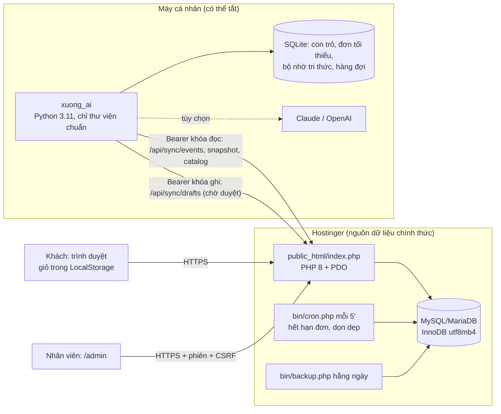
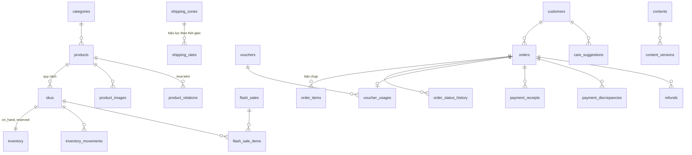
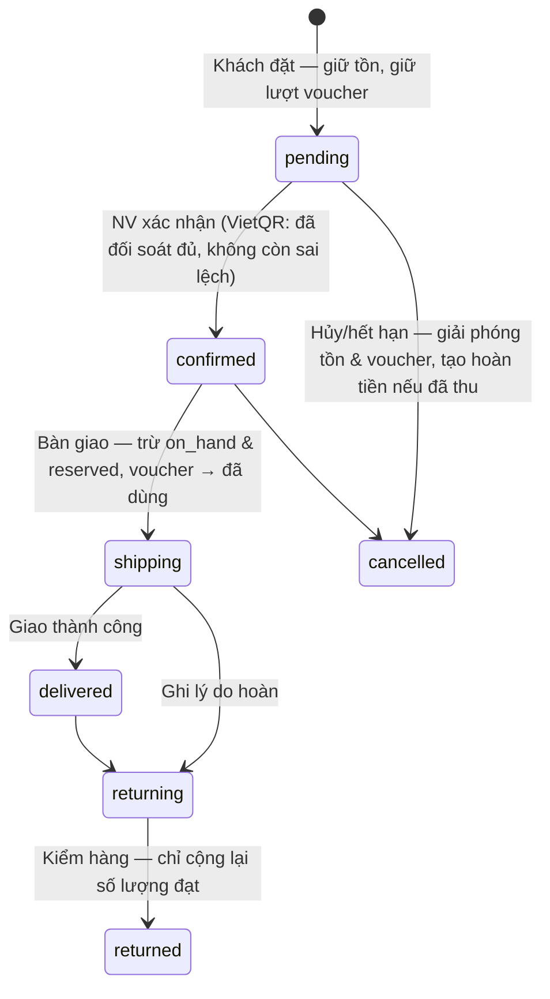

# Thiết kế kỹ thuật — Website bán hàng & dịch vụ AI cục bộ

Phiên bản 1.0 — bám theo *Đặc tả phần mềm website bán hàng v1.0*. Tên cửa hàng "Xưởng Trà Mộc" là tên tạm, đổi trong Quản trị → Cấu hình.

## 1. Kiến trúc tổng thể



Nguyên tắc chính:

- **Website không phụ thuộc máy cá nhân.** Báo giá, đặt đơn, đối soát và chat đều chạy hoàn toàn trên PHP + MySQL. Chat dùng FAQ đã duyệt, nhãn sản phẩm và giá/tồn/ưu đãi hiện hành, không gọi LLM (AT-10).
- **Máy chủ quyết định giá.** Giỏ hàng chỉ lưu `sku_id` và số lượng. Mọi số tiền được tính lại ở máy chủ, lưu bằng số nguyên VND.
- **Mọi đầu ra AI đều ở trạng thái chờ duyệt.** Python chỉ đọc dữ liệu được cấp quyền và gửi bản nháp. Website kiểm tra khóa và phạm vi quyền trên từng yêu cầu.

## 2. Cấu trúc mã nguồn

```
web/                         ← tải lên Hostinger
  public_html/               ← thư mục gốc web (chỉ thư mục này công khai)
    index.php  .htaccess  assets/{css,js,fonts,img}  uploads/
  app/                       ← NGOÀI public_html
    bootstrap.php  config.sample.php
    src/Core/                Db, Router, View, Session, Csrf, Auth, Audit, Html (lọc), Text (bỏ dấu), RateLimiter…
    src/Domain/              PricingService, OrderService, InventoryService, PaymentService, PromotionService,
                             CatalogService, ContentService, ChatService, Bm25, SyncService, DraftInbox, VietQr
    src/Http/                StoreController, ApiController, SyncController, Admin/*
    views/store/*  views/admin/*
  migrations/                001_schema.sql, 002_roles_settings.sql (áp dụng bằng bin/migrate.php)
  bin/                       migrate, seed, seed_orders (thử), create_admin, create_api_key, cron, backup
  tests/acceptance.php       AT-01…AT-11 + quy tắc bổ sung, chạy trên CSDL thử
  frontend/                  nguồn Tailwind (chỉ cần khi sửa giao diện)
ai/                          ← chạy trên máy cá nhân
  xuong_ai/                  config, store, client, sync, memory, textnorm, llm, scheduler, calibrate, agents/*
  eval/faq_eval.jsonl        tập câu hỏi hiệu chỉnh ngưỡng
  tests/                     pytest (AT-08 phía Python…)
docs/                        tài liệu này, API, triển khai, sao lưu, kết quả nghiệm thu
```

## 3. Mô hình dữ liệu



| Nhóm | Bảng | Ghi chú thiết kế |
|---|---|---|
| Sản phẩm | categories, products, skus, product_images, product_relations | Mỗi quy cách = 1 SKU với giá riêng. `products.search_text` đã bỏ dấu để tìm kiếm có dấu hoặc không dấu. `info_version` tăng khi thông tin nhãn đổi, dùng để vô hiệu tri thức AI cũ. Sản phẩm từng có trong đơn chỉ được chuyển sang ngừng bán, không bị xóa |
| Kho | inventory, inventory_movements | `CHECK (on_hand >= reserved >= 0)`. Mọi thay đổi dùng `UPDATE … WHERE on_hand - reserved >= qty`. `transition_key` UNIQUE bảo đảm mỗi lần chuyển trạng thái chỉ ghi biến động kho một lần |
| Đơn và tiền | orders, order_items, order_status_history, payment_receipts, payment_discrepancies, refunds, idempotency_keys | Đơn lưu bản chụp tên, SKU, giá, giảm giá, phí, địa chỉ. `CHECK (total = goods_subtotal - voucher_discount + shipping_fee)`, `CHECK (amount_refunded <= amount_received)`. `UNIQUE(source, bank_txn_id)` cho khoản thu |
| Ưu đãi | vouchers (reserved_count, used_count), voucher_usages, flash_sales, flash_sale_items | Lượt voucher được giữ khi đặt, chuyển sang đã dùng khi bàn giao, trả lại khi hủy trước bàn giao |
| Nội dung | contents, content_versions | Bản công khai lưu riêng (`pub_*`). Sửa bài tạo phiên bản mới, không ảnh hưởng bản đang hiển thị |
| Hệ thống | users, roles, settings, audit_logs, api_keys (SHA-256), sync_counter, sync_events, sync_inbox, job_runs, error_logs, rate_limits, chat_questions, care_suggestions | Mốc thời gian lưu theo UTC, hiển thị theo Asia/Ho_Chi_Minh |

**Lô và hạn dùng** chưa nằm trong lược đồ v1, vì đặc tả yêu cầu xưởng quyết định trước hệ thống nào quản lý. Nếu chọn website, thêm migration `003_lots.sql` (gồm `lots(sku_id, lot_code, expiry_date, on_hand)` và `order_item_lots`), rồi đổi `InventoryService::ship` sang xuất theo FEFO.

## 4. Báo giá và tạo đơn (FR-03, FR-04, §4.1)

**Tổng = tiền hàng sau Flash Sale − giảm voucher + phí giao.**

1. `POST /api/quote` tính đơn giá (áp Flash Sale đang hiệu lực, tối đa một chương trình cho mỗi SKU), voucher (một mã cho mỗi đơn), tồn khả dụng, vùng giao và biểu phí đang hiệu lực. Kết quả kèm `fingerprint` và `quote_token` (HMAC, hạn 15 phút).
   - Voucher: đơn tối thiểu tính trên tiền hàng **đủ điều kiện**, tức thuộc phạm vi áp dụng và không phải dòng Flash Sale cấm dùng voucher. Mức giảm tối đa bằng tiền hàng đủ điều kiện.
2. `POST /api/orders` cần header `Idempotency-Key` và `X-CSRF-Token`. Toàn bộ các bước sau nằm trong **một giao dịch**:
   1. Chèn khóa vào `idempotency_keys` *trước tiên*. Yêu cầu trùng đồng thời phải chờ khóa chỉ mục, rồi nhận lỗi trùng và được trả về đơn ban đầu.
   2. Báo giá lại. Nếu `fingerprint` khác hoặc token hết hạn, trả `409 QUOTE_CHANGED` kèm báo giá mới. Khách xác nhận rồi gửi lại (AT-02).
   3. Tạo khách (theo SĐT), đơn và dòng hàng (bản chụp).
   4. Giữ tồn cho từng SKU, sắp theo `sku_id` để tránh deadlock. Nếu thua tranh chấp, giao dịch hoàn tác và trả `409 OUT_OF_STOCK` (AT-01).
   5. Giữ lượt voucher bằng `UPDATE … WHERE reserved+used < limit`. Nếu thua, giao dịch hoàn tác và trả `QUOTE_CHANGED` kèm báo giá không còn giảm giá (AT-04).
   6. Ghi lịch sử trạng thái và sự kiện đồng bộ.
3. Gửi lại cùng khóa và cùng nội dung thì nhận đơn ban đầu (`200`, `replayed: true`). Cùng khóa nhưng khác nội dung, hoặc khác phiên, nhận `409 IDEMPOTENCY_CONFLICT` (AT-03). Trình duyệt giữ khóa trong `sessionStorage` cho tới khi đặt thành công, và tự thử lại tối đa 3 lần với cùng khóa khi mất mạng.

## 5. Trạng thái đơn và tồn kho (FR-05, FR-06, §4.2)



- `OrderService::transition()` khóa hàng đơn (`SELECT … FOR UPDATE`), kiểm tra cặp chuyển hợp lệ và **quyền tương ứng** (`orders.process` / `orders.return`), ghi người thao tác, thời điểm, lý do, nhật ký quản trị và sự kiện đồng bộ.
- Tác vụ hết hạn (`bin/cron.php`, mỗi 5 phút) đọc lại trạng thái trong giao dịch. Đơn đã có khoản thu hoặc sai lệch thì **không hủy** mà đánh dấu `needs_review` để nhân viên xử lý. Thời hạn mặc định: VietQR 24 giờ, COD 48 giờ (cấu hình được).
- Trạng thái thanh toán (`unpaid / partial / paid / overpaid / partially_refunded / refunded`) được tính từ khoản đã thu và khoản đã hoàn, độc lập với trạng thái giao hàng.

## 6. Thanh toán, đối soát, hoàn tiền (FR-08, §4.3)

| Tình huống | Xử lý |
|---|---|
| Khách mở trang QR / quay lại trang xác nhận | Chỉ ghi `qr_viewed_at` — **không** phải xác nhận tiền |
| NV ghi nhận giao dịch VietQR | Bắt buộc số tiền, thời điểm, mã GD (duy nhất theo nguồn). Tự dò mã đơn từ nội dung CK. Tự tạo sai lệch: `underpaid`, `overpaid`, `wrong_content`, `late`, `after_cancel`, `unmatched`. Đơn **không** tự chuyển trạng thái (AT-05) |
| COD | Chỉ ghi nhận sau "Đã giao", từ bảng kê của người giao/hãng; lệch số tiền → `cod_mismatch` |
| Xử lý sai lệch | Chấp nhận / khách bổ sung / hoàn tiền / tạo đơn thay thế / khác — bắt buộc ghi nội dung đã thống nhất với khách; khoản chưa khớp có thể gắn vào đơn |
| Hoàn tiền | Yêu cầu (tự tạo khi hủy đơn đã thu) → người có `refunds.approve` ghi mã GD hoàn + thời điểm. Tổng hoàn ≤ tổng thực nhận (kiểm tra ở mã + CHECK constraint) |

VietQR: máy chủ sinh chuỗi EMVCo của NAPAS (BIN, số TK, số tiền, nội dung = mã đơn, CRC-16/CCITT), trình duyệt vẽ mã QR bằng thư viện cục bộ — không phụ thuộc dịch vụ ngoài.

## 7. Đồng bộ với Python (§5.3)

- **Thứ tự commit**: sự kiện lấy `seq` từ `sync_counter` bằng `SELECT … FOR UPDATE` ở cuối giao dịch. Khóa giữ đến khi commit, nên giao dịch có `seq` lớn hơn luôn commit sau — con trỏ không bỏ sót sự kiện của giao dịch chậm (lỗi kinh điển của AUTO_INCREMENT). Đã kiểm bằng hai tiến trình song song (AT-08a).
- **Payload là trạng thái** đơn tối thiểu (không tên/SĐT/địa chỉ; khách nhận diện bằng `customer_key` = HMAC của SĐT) kèm `version = seq`. Python chỉ áp dụng khi version mới hơn → nhận trùng, nhận lại, phát lại sau bản chụp đều an toàn.
- Python cập nhật con trỏ trong **cùng giao dịch SQLite** với lô dữ liệu; sự kiện trùng nhận diện theo `event_id`.
- Sự kiện giữ 30 ngày; con trỏ cũ hơn mốc đã dọn → `410 CURSOR_EXPIRED` → Python tải bản chụp (`as_of_seq` đọc trước dữ liệu trong cùng snapshot nhất quán).
- Hai khóa API riêng: đọc (`events:read`, `catalog:read`) và ghi bản nháp (`drafts:write`). Website chỉ lưu SHA-256.
- Bản nháp gửi lên có `client_ref` (chống nhận trùng). Bản nháp dựa trên `info_version` cũ hơn hiện tại bị từ chối `SOURCE_OUTDATED`.

## 8. Hệ thống AI cục bộ (§6)

| Tác nhân | Đầu vào | Đầu ra (luôn chờ duyệt) | Cần LLM? |
|---|---|---|---|
| Điều phối & bộ nhớ (`scheduler`, `memory`) | — | Lịch chạy, thử lại giãn cách 1→60 phút, chạy bù khi bật máy; tri thức có trạng thái approved/pending/retired | Không |
| Nội dung SEO (`content.blog_drafts`) | Thông tin sản phẩm đã duyệt | Bản nháp blog + nguồn tham chiếu | Có |
| Tư vấn bán hàng (`content.faq_drafts`, `crosssell`) | Câu hỏi chat chưa có câu trả lời; đơn đã giao | Bản nháp FAQ; gợi ý mua kèm (lift) | FAQ: có (chỉ khi bộ nhớ không có) · Mua kèm: không |
| Chăm sóc khách hàng (`care`) | Đơn đã giao theo nhóm hàng | Danh sách đến kỳ mua lại (chỉ khách đã đồng ý) | Không |
| Bảo trì (`maintenance`) | Nhật ký tác vụ, chi phí LLM, hiệu chỉnh ngưỡng | Tệp đề xuất `.md` + ca kiểm thử | Không |

**Bộ nhớ trước, LLM sau.** Trước khi gọi LLM, tác nhân FAQ tìm trong bộ nhớ (BM25 trên SQLite) các mẫu đã duyệt hoặc đang chờ duyệt, lọc theo loại câu hỏi (giao hàng, thanh toán, đổi trả, bảo quản, cách dùng, dị ứng, ưu đãi), nhóm sản phẩm và phiên bản nguồn. Điểm tương đồng chỉ là một tín hiệu; ngưỡng được **hiệu chỉnh** bằng `eval/faq_eval.jsonl`, gồm câu gần nghĩa, câu không dấu, câu viết tắt, câu dễ nhầm và câu ngoài phạm vi. BM25 trong Python và PHP cho điểm giống hệt nhau, nên ngưỡng hiệu chỉnh dùng thẳng cho chat trên website.

**Giới hạn dữ liệu.** Python không bao giờ nhận tên, SĐT hay địa chỉ. Câu hỏi chat được che SĐT/email ngay trên website, và Python che lần nữa trước khi gửi LLM. Hạn mức số lượt gọi và chi phí theo ngày nằm trong `config.toml`; mọi lượt gọi được ghi vào `llm_usage`. Báo cáo bảo trì thống kê số lượt gọi, chi phí, tỷ lệ dùng lại bộ nhớ và tỷ lệ đạt trên tập kiểm tra.

## 9. Bảo mật và vận hành (NFR)

| Mã | Cách đáp ứng |
|---|---|
| NFR-01 | Ép HTTPS + HSTS; PDO tham số, `EMULATE_PREPARES=false`; kiểm tra đầu vào tại máy chủ; `e()` mã hóa đầu ra; lọc HTML theo danh sách trắng (DOMDocument); CSP `script-src 'self'`; `Auth::require()` trên từng thao tác; phiên cookie HttpOnly + SameSite + tái tạo ID khi đăng nhập + hết hạn khi không hoạt động; CSRF cho form quản trị và API đặt đơn; khóa tài khoản 15 phút sau 5 lần sai; giới hạn tần suất đặt đơn/chat/đăng nhập |
| NFR-02 | `app/`, `bin/`, `storage/` (sao lưu, log) nằm ngoài `public_html`; `.htaccess` chặn tệp nhạy cảm và chặn thực thi script trong `uploads/`; nhật ký quản trị ẩn mật khẩu/khóa/thông tin nhận dạng; `error_logs` che SĐT và khóa; thời hạn lưu cấu hình được (sự kiện đồng bộ, câu hỏi chat) |
| NFR-03 | Chỉ mục cho tìm kiếm/đơn/kho; đo sơ bộ p95 87 ms (đọc) và 125 ms (tạo đơn) với 20 luồng — cần đo lại trên Hostinger |
| NFR-04 | `bin/backup.php` (mysqldump hoặc PHP thuần + nén ảnh, giữ 14 bản); quy trình khôi phục đã thử (AT-11) |
| NFR-05 | Trang Giám sát: lỗi tạo đơn 24 giờ, giao dịch chờ đối soát, tác vụ hết hạn (lần chạy cuối, số lần lỗi), tuổi bản sao lưu, độ trễ đồng bộ Python; `/api/health` cho dịch vụ giám sát ngoài |
| NFR-06 | *Chính sách bảo mật thông tin* và *Điều khoản sử dụng* soạn đầy đủ (`app/content/legal/`, cài bằng migration `004_legal_pages.php`, không ghi đè trang xưởng đã sửa); biến `{{…}}` lấy từ Cấu hình và được mã hóa HTML khi hiển thị (`LegalPages::render`); chân trang hiện thông tin chủ quản. Giao hàng, thanh toán, đổi trả, liên hệ còn là bản mẫu — xưởng phải rà soát trước khi mở bán |

## 10. Làm mới dữ liệu trước khi chạy thật

`DataResetService` (dùng chung cho Quản trị → Làm mới dữ liệu và `bin/reset_data.php`). Thứ tự xử lý:

1. Xem trước số bản ghi bị ảnh hưởng.
2. **Sao lưu** (`BackupService`, tiền tố `truoc-lam-moi-`). Sao lưu lỗi thì dừng.
3. Xóa trong **một giao dịch**, theo thứ tự khóa ngoại: đơn, khách, khoản thu, sai lệch, hoàn tiền, lượt voucher, khóa gửi lại, danh sách chăm sóc, gợi ý/nội dung AI chưa xuất bản, biến động kho. Đặt tồn giữ và lượt voucher về 0. Ghi mốc tồn đầu kỳ.
4. Các tùy chọn: xóa sản phẩm, xóa ưu đãi, xóa blog/FAQ, xóa tài khoản mẫu (trừ người đang thao tác), đặt tồn về 0, xóa nhật ký thử, thu hồi khóa API.
5. Ghi sự kiện `system.data_reset` và đặt `sync_pruned_through` = seq của sự kiện đó. Mọi con trỏ Python cũ nhận `410 CURSOR_EXPIRED` và tự tải lại bản chụp.
6. Ghi nhật ký `data.reset`.

Quyền `data.reset` chỉ có ở vai trò Quản trị viên (không cấp được qua màn hình phân quyền). Khi chạy qua giao diện, phải gõ câu xác nhận và nhập lại mật khẩu. Kiểm thử ở ca EX-06.

## 11. Đăng nhập tùy chọn bằng Google / Facebook

Bổ sung ngoài đặc tả v1.0 (đặc tả cho phép mua không cần tài khoản — giữ nguyên). Không dùng thư viện ngoài.

| Thành phần | Vai trò |
|---|---|
| `Auth/OAuth` | Google: OpenID Connect mã ủy quyền + PKCE (S256) + nonce; kiểm tra `iss`, `aud`, `exp`, `nonce` của id_token nhận trực tiếp từ máy chủ token qua TLS. Facebook: mã ủy quyền, gọi `/me` kèm `appsecret_proof`. `state` lưu trong phiên, dùng một lần, hết hạn 10 phút; `next` chỉ nhận đường dẫn nội bộ. |
| `Domain/CustomerAccountService` | Tìm theo (nhà cung cấp, mã định danh) → liên kết theo email **đã xác minh** → tạo mới. Đổi mã phiên khi đăng nhập/đăng xuất. Ghi nhớ địa chỉ của đơn gần nhất. Xóa tài khoản: xóa danh tính + hồ sơ, `orders.account_id` = NULL, ghi `account_deletions`. |
| `Http/AccountController` | `/dang-nhap.html`, `/auth/{google,facebook}`, `/auth/{…}/callback`, `/tai-khoan.html` (đơn, thông tin giao hàng, nhận tin, liên kết thêm, xóa), `/auth/facebook/xoa-du-lieu` (signed_request HMAC-SHA256), `/trang-thai-xoa-du-lieu.html`. |
| Bảng | `customer_accounts` (+ `locked_at`, `locked_reason`, `session_version` từ migration 007), `account_identities` (UNIQUE provider+uid, CASCADE), `account_deletions` (nguồn `self` / `facebook` / `admin`); `orders.account_id` (SET NULL). |

Quyết định: không gộp đơn khách lẻ vào tài khoản theo SĐT (SĐT không xác minh). Đồng ý nhận tin vẫn nằm ở `customers` (theo SĐT); trang tài khoản bật/tắt cho các SĐT đã dùng trong đơn của tài khoản. Nhà cung cấp lỗi → chỉ báo lỗi trên trang đăng nhập, luồng bán hàng không phụ thuộc. Kiểm thử bằng nhà cung cấp giả lập `tests/fake_oauth.php` (ca EX-08).

### Quản trị → Tài khoản khách

Quyền riêng `accounts.manage` (mặc định chỉ Quản trị viên; cấp thêm cho vai trò khác ở màn hình Phân quyền). Mọi thao tác ghi nhật ký `account.*` kèm người thực hiện và lý do.

| Chức năng | Cách hiện thực |
|---|---|
| Danh sách, tìm kiếm | Theo email (tài khoản hoặc từ nhà cung cấp), tên, SĐT giao hàng, mã tài khoản; lọc trạng thái khóa, nhà cung cấp. Danh sách che SĐT; trang chi tiết hiện đủ cho người có quyền. |
| Chi tiết | Cách đăng nhập đã liên kết (nhà cung cấp, email, đã xác minh hay chưa, liên kết lúc, đăng nhập gần nhất), đơn đặt khi đăng nhập, trạng thái nhận tin, lịch sử thao tác. |
| Buộc đăng xuất | `customer_accounts.session_version` + 1. Phiên lưu `acct_ver` lúc đăng nhập; `CustomerAccountService::current()` so khớp trên mỗi yêu cầu → phiên cũ trên mọi thiết bị mất hiệu lực, không cần lưu danh sách phiên. |
| Khóa / mở khóa | `locked_at`, `locked_reason` (bắt buộc lý do). Khóa đồng thời tăng `session_version`. `loginWithProfile` kiểm tra khóa **trong giao dịch, sau bước liên kết** → đăng nhập bằng nhà cung cấp mới cùng email đã xác minh cũng bị chặn và danh tính vừa tạo bị hoàn tác. Khách vẫn mua hàng không cần đăng nhập. |
| Gỡ liên kết | Gỡ một danh tính (VD khách mất tài khoản Facebook) và buộc đăng xuất. Không gỡ danh tính cuối cùng (`LAST_IDENTITY`) — dùng Khóa hoặc Xóa. |
| Xóa thay khách | Dùng chung `CustomerAccountService::delete()` với nguồn `admin`; bắt buộc ghi kênh/thời điểm khách yêu cầu và xác nhận đã xác minh chủ tài khoản; cấp mã tra cứu `/trang-thai-xoa-du-lieu.html`. |

Liên kết thêm nhà cung cấp chỉ dựa trên `current()` (không đọc thẳng `$_SESSION['acct_id']`), nên phiên đã bị buộc đăng xuất/khóa không thể gắn danh tính lạ vào tài khoản. Không lưu lịch sử IP/thiết bị đăng nhập của khách — Chính sách bảo mật chỉ công bố lưu thời điểm đăng nhập gần nhất. Điều khoản sử dụng bổ sung việc xưởng có thể đăng xuất/tạm khóa và xóa thay khách (migration 008; trang đã được xưởng sửa thì bản mới vào chờ duyệt). Ca kiểm thử EX-09.

Tài khoản nhân viên: trang Tài khoản nhân viên hiện số lần nhập sai mật khẩu và trạng thái tạm khóa (5 lần sai → khóa 15 phút), có nút **Mở khóa ngay** (`Auth::unlock`, nhật ký `user.unlock`).

## 12. Truy vết yêu cầu → mã nguồn

| Yêu cầu | Nơi hiện thực |
|---|---|
| FR-01 | `CatalogService::search`, `Text::fold`, `/tim-kiem.html`, `/api/products` |
| FR-02 | `CatalogService::productBySlug`, `views/store/product.php`, `assets/js/app.js#initProduct` |
| FR-03 | `PricingService::quote`, `/api/quote`, `views/store/cart.php` |
| FR-04 | `OrderService::create`, `/api/orders`, `views/store/checkout.php` |
| FR-05 | `OrderService::transition`, `Admin/OrderController` |
| FR-06 | `InventoryService`, `Admin/InventoryController` (tồn, biến động theo SKU/mã đơn) |
| FR-07 | `PromotionService`, `Admin/PromoController` |
| FR-08 | `PaymentService`, `VietQr`, `Admin/PaymentController` |
| FR-09 | `ContentService`, `Admin/ContentController` |
| FR-10 | `ChatService`, `Bm25`, `/api/chat` |
| FR-11 | `ai/xuong_ai/agents/care.py`, `DraftInbox::careList`, `Admin/CareController` (lọc theo đồng ý) |
| FR-12 | `Audit`, `Admin/SystemController::audit` (lọc theo đối tượng, người, thời gian) |
| Đăng nhập Google/Facebook | `Auth/OAuth`, `CustomerAccountService`, `AccountController`, `views/store/{login,account,deletion_status}.php` — ca EX-08 |
| Quản trị tài khoản khách | `CustomerAccountService::{adminSearch,lock,unlock,revokeSessions,unlinkIdentity,delete}`, `Admin/CustomerAccountController`, `views/admin/customer_account{s,_show}.php`, migration 007 — ca EX-09 |
| AT-01…AT-11 | `web/tests/acceptance.php`, `ai/tests/test_sync.py` — kết quả ở `docs/KET-QUA-NGHIEM-THU.md` |

## 13. Địa chỉ trang (URL) một cấp, đuôi .html

Mọi trang khách xem có dạng `/{đường-dẫn}.html` (`App\Domain\Urls`, hàm view `page_url()` / `fixed_url()`):

| Trang | Địa chỉ | Địa chỉ cũ (301) |
|---|---|---|
| Danh mục, sản phẩm, bài blog, trang chính sách | `/{slug}.html` | `/danh-muc/…`, `/san-pham/…`, `/blog/…`, `/chinh-sach/…` |
| Giỏ hàng, đặt hàng, tìm kiếm, Flash Sale | `/gio-hang.html`, `/dat-hang.html`, `/tim-kiem.html`, `/flash-sale.html` | `/gio-hang`, `/thanh-toan`, `/tim-kiem`, `/flash-sale` |
| Blog, hỏi đáp | `/blog.html`, `/hoi-dap.html` | `/blog`, `/hoi-dap` |
| Tài khoản, đăng nhập, trạng thái xóa dữ liệu | `/tai-khoan.html`, `/dang-nhap.html`, `/trang-thai-xoa-du-lieu.html` | `/tai-khoan`, `/tai-khoan/dang-nhap`, `/tai-khoan/trang-thai-xoa` |
| Xác nhận đơn | `/don-hang-{mã}.html?t=…` | `/don-hang/{mã}` |

Giữ nguyên: `/admin/*`, `/api/*`, `/sitemap.xml`, `/auth/*` (đã khai báo với Google/Facebook) và các địa chỉ nhận biểu mẫu POST `/tai-khoan/…`. Trang đặt hàng là `/dat-hang.html` vì `/thanh-toan.html` thuộc trang "Chính sách thanh toán".

- **Một không gian đường dẫn.** Danh mục, sản phẩm, bài blog, trang dùng chung `/{slug}.html`, nên `Urls::unique()` bảo đảm đường dẫn duy nhất giữa các loại và không trùng tên trang cố định (`gio-hang`, `dat-hang`, `blog`…, tiền tố `don-hang-`). Hỏi đáp không có trang riêng nên không tính.
- **Giải địa chỉ** (`Urls::resolve`): danh mục → sản phẩm (gồm sản phẩm ngừng bán, để hiện thông báo) → blog → trang. Route cố định đăng ký trước route `/{slug}.html`. Router thoát phần chữ cố định trong mẫu (dấu `.` của `.html`).
- **Link cũ** chuyển hướng 301, giữ nguyên tham số truy vấn (`?trang=2`, `?q=`, `?t=`, `?ma=`). Migration 009 đổi đường dẫn các mục đang trùng (giữ mục ưu tiên hơn: danh mục > sản phẩm > blog > trang; mục bị đổi thêm hậu tố `-san-pham`, `-bai-viet`…), lưu địa chỉ cũ vào `url_aliases` để link cũ vẫn tới đúng chỗ, và ghi nhật ký `url.slug_renamed`. Ca kiểm thử EX-10.
- Nội dung đã xuất bản (blog, FAQ) có link kiểu cũ trong thân bài vẫn dùng được nhờ chuyển hướng; trang pháp lý được cập nhật link qua migration 009.

