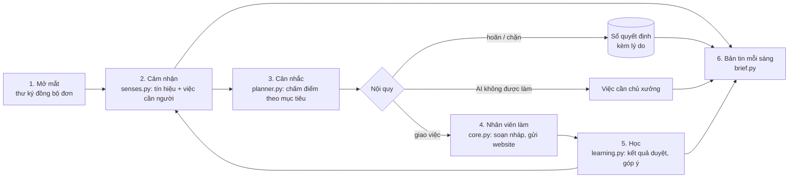

# Văn phòng AI chăm sóc website: bộ não "Trưởng văn phòng"

Phiên bản 1.0. Mã nguồn ở `ai/xuong_ai/brain/`. Tài liệu này bổ sung cho `docs/THIET-KE.md` §8.

## 1. Vì sao cần bộ não

Trước đây dịch vụ AI là một **bộ hẹn giờ**: đến giờ là chạy từng tác nhân, dù có việc để làm hay không. Không có thành phần nào trả lời được các câu hỏi:

- Lúc này việc gì đáng làm nhất, và vì sao?
- Nhân viên còn sức duyệt thêm bản nháp không, hay đang tồn 20 bản?
- Bản nháp gửi lên được duyệt, bị sửa hay bị từ chối? Lần sau nên viết khác thế nào?
- Việc nào AI không được tự làm, và cần báo cho chủ xưởng?

Bộ não thay bộ hẹn giờ bằng một vòng làm việc có lý do rõ ràng, có ghi sổ và biết học. Các nguyên tắc của thiết kế gốc vẫn giữ nguyên:

- Mọi đầu ra đều **chờ duyệt** trên website.
- Python **không nhận thông tin cá nhân** của khách.
- Website **không phụ thuộc** máy cá nhân.

## 2. Vòng làm việc mỗi nhịp



Mặc định mỗi nhịp cách nhau 60 giây (`tick_seconds`). Giác quan chỉ đọc SQLite cục bộ, không gọi mạng hay LLM, nên chạy mỗi phút vẫn rẻ. Việc tốn tài nguyên chỉ chạy khi có tín hiệu và qua được nội quy.

## 3. Nhân sự

| Mã | Nhân viên | Việc | Dùng LLM |
|---|---|---|---|
| `truong_phong` | Trưởng văn phòng (bộ não) | Quan sát, cân nhắc, giao việc, rút kinh nghiệm, viết bản tin | Không |
| `thu_ky` | Thư ký dữ liệu | `sync`, `catalog`, `feedback`, gửi lại hộp thư đi (`outbox`) | Không |
| `tu_van` | Tư vấn viên | `faq_draft`: soạn **một** FAQ cho **một** cụm câu hỏi | Có |
| `bien_tap` | Biên tập SEO | `blog_draft`: soạn **một** bài cho **một** sản phẩm | Có |
| `cham_soc` | Chăm sóc khách | `care_list`: khách đến kỳ mua lại, chỉ khách đã đồng ý, không nhắc lại trong 30 ngày | Không |
| `phan_tich` | Phân tích bán hàng | `crosssell`: tối đa 5 cặp mua kèm **mới** mỗi ngày, điểm cao trước | Không |
| `ky_thuat` | Kỹ thuật bảo trì | `maintenance`: hiệu chỉnh ngưỡng chat, đề xuất bảo trì | Không |
| `chu_xuong` | Chủ xưởng / nhân viên | Nhận "việc cần người" | — |

## 4. Mục tiêu và cách chấm điểm

**Điểm = trọng số mục tiêu × mức độ tín hiệu × hệ số tin cậy.**

| Mục tiêu (`[brain.goals]`) | Mặc định | Ý nghĩa |
|---|---|---|
| `van_hanh` | 1,0 | Website vận hành ổn định, dữ liệu đồng bộ kịp thời |
| `tra_loi_khach` | 0,8 | Khách hỏi gì cũng có câu trả lời đúng |
| `giu_chan` | 0,6 | Nhắc khách cũ mua lại đúng lúc |
| `gia_tri_don` | 0,4 | Gợi ý mua kèm |
| `noi_dung_seo` | 0,4 | Mỗi sản phẩm có bài viết |

- **Mức độ** (0–1) do giác quan tính. Ví dụ: câu hỏi chưa có câu trả lời tăng theo log của số lượt hỏi, và bài blog thiếu được ưu tiên theo doanh thu 90 ngày của sản phẩm.
- **Hệ số tin cậy** = 0,5 + độ tin cậy đã học (xem §7), nằm trong khoảng 0,5–1,5. Loại bản nháp hay được duyệt sẽ được làm trước.
- Đồng bộ đơn luôn có điểm 10 và luôn chạy đầu tiên, vì mọi nhận định khác dựa vào dữ liệu này.

Việc điểm cao được xét trước, nên được dùng hạn mức trước (lượt LLM, sức duyệt của nhân viên).

## 5. Giác quan: tín hiệu và việc cần người

| Phát hiện | Cách đo | Kết quả |
|---|---|---|
| Việc định kỳ đến hạn | Bảng `jobs.next_run` (tự giãn cách 1→60 phút khi lỗi) | Tín hiệu → thư ký / kỹ thuật |
| Câu hỏi chat chưa có câu trả lời | Gom cụm gần nghĩa, rồi tìm trong bộ nhớ (FAQ đã duyệt **và** bản nháp đang chờ) với ngưỡng đã hiệu chỉnh | Tín hiệu `faq_gap` → tư vấn viên |
| Câu hỏi thuộc loại "chỉ người" (mặc định: dị ứng / sức khỏe) | `question_type` | **Việc cần người**, không gửi LLM |
| FAQ/blog bị từ chối ≥ `max_ai_attempts` lần | `brain_feedback` | **Việc cần người** (nên tự viết) |
| Sản phẩm chưa có bài blog | `published_blogs` trong catalog + bản nháp đúng `info_version` | Tín hiệu `blog_gap` → biên tập |
| Sản phẩm thiếu thành phần / cách dùng / bảo quản / dị ứng | Catalog | **Việc cần người**: AI không được bịa nhãn |
| Đơn 24 giờ thấp bất thường | Kiểm định Poisson, λ = trung bình cắt 28 ngày, p < 1%; chỉ xét khi đồng bộ còn mới (< 2 giờ) và đủ lịch sử (≥ 14 ngày, λ ≥ 1,5) | **Việc cần người** (kiểm tra website, thanh toán, tồn) |
| Đơn tăng vọt | p < 0,1% và vượt λ + 5 | Ghi chú trong bản tin |
| Tỷ lệ hủy tăng | 2–8 ngày trước so với 9–60 ngày trước: ≥ 3 đơn, ≥ 15% và ≥ 2 lần mức thường | Việc cần người |
| Đơn chờ xác nhận > 3 ngày / đã xác nhận > 5 ngày chưa giao | Trạng thái đơn | Việc cần người (cron hết hạn có thể hỏng) |
| Đơn chuyển khoản thiếu/thừa chưa xử lý | `payment_status` | Việc cần người |
| Khách đến kỳ mua lại | `care.due_list`, bỏ khách đã nhắc trong 30 ngày | Tín hiệu → chăm sóc khách |
| Cặp mua kèm mới | `crosssell.new_pairs`, chỉ các cặp chưa từng gửi | Tín hiệu → phân tích |
| Bản nháp chờ duyệt > 7 ngày | `/api/sync/feedback` → `backlog` | Việc cần người |
| Website không phản hồi ≥ 3 lần, LLM lỗi 3 lần liền, việc lỗi lặp lại | `jobs`, `llm_usage`, `brain_tasks` | Việc cần người |

Việc cần người **tự đóng** khi điều kiện không còn, ví dụ khi website phản hồi lại hoặc chủ xưởng đã bổ sung nhãn.

## 6. Nội quy (thứ tự kiểm tra)

1. **Công tắc tạm dừng**: `paused = true` trong `config.toml`, hoặc có tệp `STOP` cạnh `config.toml`. Khi đó mọi việc bị chặn.
2. Bản nháp đã soạn và đang chờ duyệt → **bỏ qua**, không soạn lại.
3. Lần trước lỗi → **hoãn** theo giãn cách 1, 2, 4, …, 60 phút. Lỗi 5 lần trong 24 giờ → **chặn** và báo người.
4. Website chưa phản hồi (ngắt mạch) → mọi việc cần website bị **hoãn**, chỉ việc đồng bộ được thử lại.
5. Loại bản nháp bị từ chối liên tục (≥ 5 lần duyệt, độ tin cậy < 20%) → **chặn** cho tới khi chỉnh lời dặn.
6. Chưa bật LLM → việc soạn nháp bị **chặn**. Hết hạn mức LLM trong ngày → **hoãn**.
7. Hạn mức theo ngày (`[brain.daily_caps]`): mặc định 5 FAQ, 2 blog, 1 danh sách chăm sóc, 1 lượt mua kèm, 1 bảo trì.
8. **Sức duyệt của nhân viên**: tổng bản nháp chờ duyệt không vượt `max_pending_review` (mặc định 15). Việc mua kèm được cắt bớt cho vừa chỗ còn lại.
9. Mỗi nhịp tối đa `max_tasks_per_tick` việc. Việc còn lại để nhịp sau.

Mọi quyết định đều được ghi vào `brain_decisions` kèm lý do. Sổ chỉ ghi khi quyết định đổi, nên không bị lặp mỗi phút.

## 7. Học từ phản hồi

Website có thêm API `GET /api/sync/feedback` (khóa đọc). API này trả trạng thái của từng bản nháp AI và số bản đang chờ duyệt. Chi tiết ở `docs/API.md`.

| Trạng thái | Nghĩa | Trọng số khi học |
|---|---|---|
| `approved` | Duyệt nguyên văn | 1 đạt |
| `edited` | Nhân viên sửa rồi mới xuất bản | 0,6 đạt / 0,4 không đạt |
| `rejected` (kèm góp ý) | Từ chối | 1 không đạt |
| `retracted` | Xuất bản rồi gỡ | 1 không đạt |
| `invalid` | Website từ chối khi nhận, thường do nhãn đổi sau khi soạn | Không tính vào chất lượng |

- **Độ tin cậy** của mỗi loại (FAQ, blog, mua kèm, chăm sóc) là trung bình của phân phối Beta(1 + đạt, 1 + không đạt) trên 90 ngày gần nhất. Chưa có dữ liệu thì bằng 0,5.
- **Góp ý** khi từ chối hoặc sửa được đưa vào lời dặn của lần soạn sau ("Người duyệt của xưởng đã góp ý…"). Văn phòng nhớ yêu cầu của người duyệt mà không cần ai sửa mã.
- **Bản nháp bị từ chối** bị loại khỏi bộ nhớ "đang chờ duyệt", để khoảng trống mở lại và được soạn lần 2 (mã `…:r2`). Bị từ chối `max_ai_attempts` lần thì chuyển người viết.
- Website bản cũ chưa có API phản hồi: văn phòng suy ra FAQ nào đã được duyệt từ danh sách FAQ đã xuất bản.

## 8. Bản tin và lệnh

```bash
python -m xuong_ai run        # văn phòng làm việc nền (bộ não)
python -m xuong_ai think      # xem bộ não đang nghĩ gì: tín hiệu, việc cần người, quyết định — KHÔNG làm, KHÔNG ghi
python -m xuong_ai tick       # làm đúng một nhịp
python -m xuong_ai office     # nhân sự, độ tin cậy đã học, việc cần chủ xưởng
python -m xuong_ai brief      # viết bản tin ngay
python -m xuong_ai run --legacy   # bộ hẹn giờ cũ (dự phòng)
```

Mỗi sáng sau `brief_hour` (mặc định 7 giờ, giờ Việt Nam), văn phòng ghi `office/<ngày>-ban-tin-van-phong.md` gồm các phần:

- **Cần anh/chị quyết**
- Tình hình bán hàng
- Bộ não nhận thấy
- Văn phòng đã làm (24 giờ)
- Đang chờ duyệt trên website
- Việc đã hoãn/chặn và lý do
- Bài học từ phản hồi

Bản tin được viết theo mẫu cố định, không gọi LLM, nên không tốn chi phí và không bịa số liệu.

## 9. Sổ sách (SQLite cục bộ)

| Bảng | Nội dung |
|---|---|
| `brain_signals` | Tín hiệu đang mở / đã hết, lần đầu và lần cuối thấy |
| `brain_tasks` | Sổ giao việc: ai làm, tham số, kết quả, lỗi |
| `brain_decisions` | Quyết định giao / hoãn / chặn / bỏ qua kèm lý do |
| `brain_escalations` | Việc cần người (mở / đã đóng) |
| `brain_feedback` | Kết quả duyệt từng bản nháp + góp ý |
| `brain_care_sent` | Khách (chỉ mã băm `customer_key`) đã đưa vào danh sách chăm sóc |
| `brain_ticks` | Nhật ký từng nhịp |

Sổ cũ hơn 60 ngày được dọn mỗi ngày. Không bảng nào chứa tên, SĐT hay địa chỉ.

## 10. Kiểm thử

- `ai/tests/test_brain.py` có 9 kịch bản, chạy với website giả:
  - soạn FAQ, chuyển câu hỏi dị ứng cho người;
  - giới hạn sức duyệt;
  - không có LLM;
  - từ chối → soạn lại kèm góp ý → chuyển người;
  - website sập → ngắt mạch → tự phục hồi;
  - phát hiện đơn tụt;
  - không nhắc lại khách đã chăm sóc;
  - công tắc tạm dừng;
  - `think` chỉ đọc và bản tin đủ các phần.
- `web/tests/acceptance.php` có thêm EX-12 cho API phản hồi: duyệt, sửa rồi duyệt, từ chối kèm góp ý, chờ duyệt, website từ chối, không lộ dữ liệu khách.
- Đã chạy thử đầu-cuối với website PHP thật và dữ liệu mẫu. Kết quả:
  - đồng bộ 109 đơn;
  - soạn FAQ và blog;
  - gửi danh sách chăm sóc và gợi ý mua kèm;
  - sau khi nhân viên duyệt, sửa và từ chối, văn phòng học đúng trạng thái và soạn lại bài bị từ chối kèm góp ý;
  - khi tắt website: báo người sau 3 lần lỗi, tự đóng khi website chạy lại.

## 11. Hướng mở rộng

- Trang **Quản trị → Văn phòng AI** trên website để xem bản tin, việc cần người và độ tin cậy, không cần mở máy cá nhân. Cần thêm loại `office_report` cho `/api/sync/drafts`.
- Cho phép chủ xưởng trả lời "việc cần người" ngay trên website (đã xử lý / bỏ qua), để bộ não học thêm từ đó.
- Học trọng số mục tiêu từ kết quả kinh doanh, ví dụ FAQ mới có làm giảm câu hỏi chuyển hotline không, hoặc gợi ý mua kèm có làm tăng giá trị đơn không.
